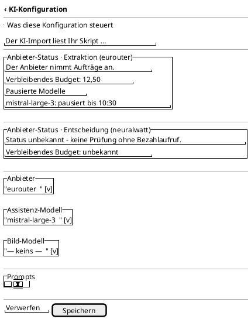

<!-- SPDX-License-Identifier: AGPL-3.0 -->
<!-- Copyright (C) 2024-2026 Breakdown RS Contributors -->
<!-- Co-authored-by: deepseek-v4.1-flash (opencode-go) -->

# AI-Configuration — Screen Spec

## Purpose & Context
Configures the AI import: the extraction provider and model, an optional
separate Decision (scoring) provider, the API key (stored server-side in the
Vault) and the prompt texts. Since issue #942 it also **reports the state of the
caller's own provider account** — is the key accepted, how much budget is left,
and which `(provider, model)` pairs are currently paused — so a user does not
have to spend an import cycle to find out that the provider cannot pay.

## Navigation
Pushed from Settings → "KI" → "KI-Konfiguration" (`settings-ai-config`). Back
returns to Settings (with an unsaved-draft confirmation, see Interactions).
Route parameters: none. The entry point is ALWAYS rendered (issue #809) and the
server decides the permission: a `403` renders the administrator narrative in
place (issue #816).

AUTHZ-GATE: every read this screen dispatches — the config discovery, the
provider/model catalogs and the provider-health read — is preceded by the
client-side mirror of the server's `has_active_credential_role` predicate
(`myCapabilitiesProvider`, `GET /v1/me/capabilities`). A RESOLVED denial
suppresses the dispatch entirely; an UNKNOWN answer (pending or failed) is never
a denial — the request proceeds and the server stays authoritative.

## Location & Context
N/A — the screen is not part of the planning hierarchy and is pushed without a
`PlanningLocation`, so the location strip stays hidden.

## Layout

## Components & Semantics

| Element | M3 component | Semantics / meaning | Copy key |
|---|---|---|---|
| Provider-status card | Card (one per configured provider) | The caller's own account usability, remaining budget and the paused model pairs. Sits ABOVE the form: it answers "can my import run at all" before any editing. | `aiConfigProviderHealthTitle(role, provider)` |
| Card title | Text (title-small) | Names the role and the provider wire key — never the Dart enum spelling | `aiConfigProviderHealthTitle` |
| Account line | Text (body) | One of: usable / key rejected or quota exhausted / unknown / no key stored / no permission / read failed / checking | `aiConfigProviderHealth{Usable,NotUsable,Unknown,Unconfigured,Forbidden,Failed,Checking}` |
| Budget line | Text (body) | Three-valued and never a fabricated zero: a figure, "no limit configured", or "unknown" | `aiConfigProviderHealthBudget{Remaining,Unlimited,Unknown}` |
| Paused models | Text list | Only non-`closed` breaker rows; a granted half-open trial reads as "trial granted" (the grant is what the server published — the call may not have started yet), a scheduled probe names its time | `aiConfigProviderHealthHeldTitle`, `…HeldPair`, `…HeldPairNoEta`, `…Trial` |
| Retry | Outlined button | Re-reads the health route (only for a failed read; a denial has no retry — retrying cannot flip a role) | `commonRetry` |

## States

| State | What the user sees | Source |
|---|---|---|
| Checking | "Anbieter wird geprüft …" | `aiProviderHealthProvider` in `AsyncLoading` |
| Usable + budget | "Der Anbieter nimmt Aufträge an." + "Verbleibendes Budget: 12,50" | `probe_status: usable`, `budget.remaining: <n>` |
| Usable + no limit | … + "kein Limit hinterlegt" | `budget.remaining: null` |
| Usable + budget unknown | … + "unbekannt" | `budget: null` (the provider reports no budget read) |
| Quota exhausted / key rejected | "Der Anbieter lehnt den Schlüssel ab oder das Guthaben ist erschöpft …" + a measured `0` if the provider reported one | `probe_status: not_usable` |
| Unknown | "Status unbekannt – …" (no probe available, timeout, transport failure) | `probe_status: unknown` |
| Unconfigured | "Für diesen Anbieter ist noch kein Schlüssel hinterlegt." | `credential_configured: false` |
| Forbidden | "Keine Berechtigung für die Anbieter-Prüfung." on the error container, no retry | a resolved capability denial (#816) |
| Read failed | "Der Anbieter-Status konnte nicht gelesen werden." + Retry | transport failure / 5xx of the health route |
| Paused pair | "mistral-large-3: pausiert bis 10:30" | a non-`closed` row in `breakers` |

**A provider problem is never a backend problem.** An unreachable, unpaid or
paused provider must never render as "Backend noch nicht erreichbar": that claim
belongs to `aiConfigReachabilityProvider` (`GET /v1/health`) alone (issue #809,
#942 F5).

## Interactions
- Opening the screen dispatches the config discovery and — for every configured
  provider — one health read. The card is auto-disposed with the screen, so a
  revisit re-reads (the server caches its own answer for one minute, keyed by
  user + provider + Vault binding).
- Retry re-reads the health route only; it never re-dispatches a command.
- Saving a config re-reads discovery and therefore the health card of the new
  provider.
- Unsaved drafts block back navigation behind a discard confirmation.

## Input & Validation
The provider/model pickers and the masked key field are documented by the
implementing change; this spec only adds the read-only status card. The card has
no inputs.

## Accessibility & i18n
- Every string comes from the ARB catalog (German template + English catalog);
  the card never interpolates a backend `detail` — it renders per `probe_status`
  and per registered problem code (ADR-031).
- The paused-model list is plain text per row so a screen reader announces each
  pair separately.
- The provider wire key is shown verbatim (it is a stable identifier, not prose).

## Tests
- `test/features/ai_import/ai_config_screen_test.dart` → group "provider health
  + budget (issue #942 W4/W5)": usable + budget, no-limit, unknown budget,
  exhausted quota (and "never the backend-unreachable claim"), unconfigured,
  paused pair, denied rendering (no retry), the `#816` dispatch gate on the real
  provider, the unknown-capability dispatch, a failed read with Retry, and a
  distinct decision provider getting its own card.
- Goldens: `ai_config_configured_{light,dark}_{android,macos}.png` include the
  status card.
