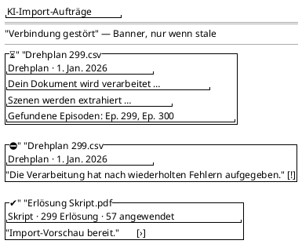
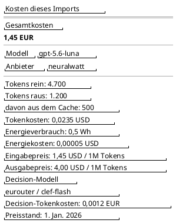

<!-- SPDX-License-Identifier: AGPL-3.0 -->
<!-- Copyright (C) 2024-2026 Breakdown RS Contributors -->
<!-- Co-authored-by: glm-5.3-flash (opencode-go) -->
<!-- Co-authored-by: glm-5.3-flash-flex (neuralwatt) -->
<!-- Co-authored-by: deepseek-v4.1-flash (opencode-go) -->

# AI-Import-Aufträge (ai-import-jobs) — Screen Spec

## Purpose & Context

The persistent "what did I import" surface (issue #547): every AI-import
job the user started stays reachable after leaving the job-status screen.
It closes the silent dead-letter hole — a job that ends in
`dead_letter` or `payload_unavailable` after the user navigated away was
previously unlearnable. The list renders the caller's jobs newest-first
from the cache-then-revalidate `aiImportJobsView` projection.

## Navigation

Reached from the main **Settings** screen's AI section — the
persistent "KI-Import-Aufträge" tile (issue #644): always reachable,
even when zero jobs need attention. Two further paths: the
production-overview **active-jobs summary row** (shown while any known
job needs attention) and, from the jobs screen's empty state, the CTA
into the import entry. Every push carries `RouteSettings(name:
'ai-import-jobs')`, so the apply outcome's "back to imports"
`popUntil` contract resolves from any entry. Row selection pushes the job
status screen (`AiJobStatusScreen`) — the screen that owns the single
foreground status watch; back returns to the caller. No route parameters.
AUTHZ-GATE: the jobs list route is ownership-scoped server-side; the
client resolves the authenticated session before the fetch (no session →
no request) and denials surface through code-keyed copy
(`jobWatchForbidden` / `aiJobsLoadError`), never backend `detail`. The
sibling production-overview import entry keeps its block-scope gate —
this screen does not weaken it (it dispatches no block-scoped write).

## Layout

Expanded (window width class ≥ medium): the same single-column list
constrained to a content max-width with wider gutters — a jobs list never
splits into master/detail panes; the detail surface is the pushed status
screen, on every window size.

## Components & Semantics

| Element | M3 component | Semantics | Copy key |
|---|---|---|---|
| Screen title | Top app bar | Screen identity (plural) | `aiJobsTitle` |
| Job row | List item | Pushes the job status screen (the single-watch owner) | row key |
| Row title | Text | The uploaded document's own file name, at most two lines then ellipsized (issue #763); a job without a name keeps „Drehplan · 1. Jan. 2026" | server `source_file_name`, else `aiJobsRowSubtitle` |
| Row identity line | Text | The imported target once an apply ran: `Skript · 299 Erlösung · 57 angewendet`, `(+n)` for further episodes (issue #763); a named but unapplied row shows `kind · date` here instead, an unnamed one shows nothing (the title already carries it) | `aiJobsRowKindEpisode` / `aiJobsRowEpisodeMore` / `aiJobsRowEpisodeNumber` / `aiJobsRowEpisodeNumberName` / `aiJobsRowApplied` / `aiJobsRowSubtitle` |
| Row status | Text | One of the six honest status copies, always visible next to the icon | `aiImport.jobStatus` |
| Status icon | Icon | Per-status glyph (see glossary); error-colored for terminal failures — reinforcement only, never the sole carrier | status glyphs |
| Retry budget | Text | Retryable `failed` rows show `Versuch {retries} von {maxRetries}` | `aiJobRetryBudget` |
| Row stage | Text | **In-progress** rows (`pending`/`running`) with a published `progress` show the localized extraction stage (issues #664, #763) — a terminal row never does, whatever the fetched row still carries | `aiJobStage*` |
| Row episodes | Text | In-progress rows with discovered episodes show the summary line **with its values** (`Gefundene Episoden: Ep. 299, Ep. 300`) — a label without values never renders (issue #763) | `aiJobEpisodesSeenValues` |
| Row scenes rebuilt | Text | A job whose extraction had to rebuild rows from the document headings states it (`53 Szene(n) nur aus Dokument-Metadaten`, issue #758) — the count comes from `telemetry.scenes_synthesized`, which the Drift cache does not persist, so the line appears with the authoritative read. `0`/absent renders nothing: a clean import is never labelled | `aiJobsRowScenesRebuilt` |
| Last-error indicator | Icon | Presence indicator on rows carrying a server error detail; the raw text renders only on the status screen, as secondary detail | status glyph |
| Stale banner | Banner | Failed refetch serving retained cached rows | `seasonsStaleBanner` |
| Error state | Card + button | Copy keyed on the problem `code`; retry re-runs the list route | `aiJobsLoadError` / `aiJobCheckAgain` |
| Empty state | Icon + text + button | Honest "no import yet" + CTA into the import entry | `aiJobsEmpty` / `aiJobsEmptyCta` |
| Settings AI-imports entry | List item (push, chevron) | Persistent entry from the Settings AI section (issue #644) | `settings.aiImports` + `settings.aiImportsSubtitle` |
| Production-overview summary row | List item | Visible while any known job needs attention (any non-`succeeded` status) | `planningActiveJobRow` / `aiJobsActiveBadge` |

## States

Loading: skeleton rows (visible only before the very first cache seed —
the cached-first paint makes cold starts render rows immediately). Data:
newest-first rows. Empty: honest "no import yet" with the import CTA.
Error: full error state when no rows are retained; a banner above the
retained rows otherwise — both keyed on the stable problem `code`, never
`detail`. Stale: the shared cache-staleness banner when a failed refetch
left only cached rows. There is NO optimistic layer: this boundary
dispatches no commands.

## Interactions

Row tap pushes the job status screen, which arms the single foreground
watch (D5) and owns the re-arm (`aiJobCheckAgain`) and preview
(`aiJobReviewPreview`) affordances; leaving it disposes the watch. The
list itself arms NO watch and dispatches nothing — pull-to-refresh
re-runs exactly the list route, which is the status authority for rows;
there is no per-row polling and no fabricated progress indicator (the
wire carries `retries`/`max_retries`, never a percentage; since issue
#664 a running row MAY carry a server-published `progress` stage/chunk
summary — rendered from the fetched row only, never from a client-side
stream or fabricated count, and gated on the row's STATUS so a finished
job cannot advertise the stage it finished at; issue #763). The production-overview summary row and the
Settings AI-imports entry push this screen and never arm a watch — the
SSE stream (`GET /v1/ai-import/jobs/{id}/events`, issue #664) is opened
exclusively by the job status screen while foregrounded.

## Input & Validation

N/A — read-only screen (no forms, no commands).

## Accessibility & i18n

Every row renders its meaning as visible text (file name, kind, date, the
imported episode(s) with their applied counts, status, retry budget, and
for in-progress rows the stage/episode summary); icons reinforce
only and terminal failures additionally use the error color, so color is
never the sole carrier either. All copy via the ARB catalogs (`aiJobs*`,
`jobStatus*`, `jobWatch*`, `aiJobRetryBudget`, `aiJobStage*`); 
backend `detail` text never renders on this screen. Row semantics announce
the title (name or kind + date), the identity/target line and the status.

## Job status — the recorded import target (issue #771)

The job status screen repeats the target the submit screen showed, so an import
is attributable after the fact instead of only being believed. The value comes
from the job row's own snapshot (`AiImportJob.target`) — no second read, no
guessed season.

| Element | M3 component | Semantics | Copy key |
|---|---|---|---|
| Target card | Card (surface container highest) under the status card | `{season} · {block}` from the server-snapshotted `season_number` / `block_number`. A job without a snapshot (pre-#771 row, or a fresh upload whose season read failed) renders the honest, cause-neutral "not recorded" narrative instead of an invented season | `aiImportTargetTitle` / `aiImportTargetLine` / `aiImportTargetNotRecorded` |

## Preview & Apply — detected vs extracted scenes (issue #758)

The script preview's subtitle states what the DOCUMENT had, not only what the
model produced, and names the rows that had to be rebuilt because their chunk
returned nothing. Before this, a 57-heading script that produced 4 model rows
rendered as a 4-scene import.

| Element | M3 component | Semantics | Copy key |
|---|---|---|---|
| Script subtitle | Body-small text under the payload title | `{rows} Skript-Szene(n) · {detected} erkannt · {extracted} extrahiert` plus `· {n} aus Dokument-Metadaten ergänzt` when rows were rebuilt. Renders the row count ALONE when `scenes_detected` is `0`/absent (a preview extracted before the counters existed — a ratio is never invented) | `aiPreviewScriptSubtitle`, `aiPreviewScriptReconciliation`, `aiPreviewScriptSynthesized` |
| Rebuilt-row uncertainty | The existing uncertainty notice | Each rebuilt row carries a non-blocking `dropped_row` uncertainty (`field = "extraction"`) from the server, so the apply stays enabled and the missing content is visible row by row | `aiPreviewUncertainty` |

## Preview & Apply — Decision Model star ratings (issue #723)

When the configured Decision Model scored the extraction, the preview
and apply cards render calibrated scores as **1–5 star ratings** via the
shared `AiScoreStars` component (`lib/design/components/`):

| Element | M3 component | Semantics | Copy key |
|---|---|---|---|
| Scene / synopsis / shooting-day score | Icon row (`star` filled vs. `star_border` outline) + label | Machine-evaluated review aid — never a decision; renders NOTHING when the score is `null` (honest absence, no Decision Model / failed pass) | `aiPreviewSceneScore`, `aiPreviewSynopsisScore`, `aiPreviewShootingDayScore`, `aiScoreStarsLabel` |
| Day-group score (apply card) | Icon row on the decision row | Same mapping, aggregated per day group (`DraftShootingDay.score`) | `aiScoreStarsLabel` |
| Low-score filter | `FilterChip` pair above the rows | Narrows the VISIBLE rows to any score `<= 3★` (`< 0.70`); the apply payload keeps every row — filtering is view-only | `aiPreviewFilterAll`, `aiPreviewFilterLowScore` |
| Banner note (scored) | Tertiary banner text | Frames the stars as machine-evaluated under EU AI Act Art. 50; the unscored note (`aiPreviewAiNote`) stays when no score exists | `aiPreviewAiNoteScored` |

The Decision / Scoring Model itself is configured on the AI config screen
(provider + curated model picker, "Use same API key as extraction" toggle,
separate split-billing key field — keys `aiConfigDecision*`); see the
`flutter-ai-config` OpenSpec spec.

## Job status — the cost card (issues #761, #768)

The card was a flat column of equally weighted `bodySmall` lines: the two
facts the user actually wants — **what it cost** and **which model produced
it** — were buried between token counts, snapshot rates, energy figures and a
price date, and the provider was not rendered at all even though
`JobTelemetrySummary.provider` carries it. Since #768 the snapshot also has
more than one priced component (the Decision Model may bill at a different
provider/model) and an explicit `CostTotal` that states whether a sum may be
shown. The redesign therefore promotes a **hero figure** and the
**model/provider identity**, and demotes everything else to icon-prefixed,
grouped detail rows — without dropping a single figure from #675.

Compact (window width class < medium): the same card, one column — the
identity chips wrap instead of shrinking (`Wrap`), and a long curated model id
breaks onto a second line and is then ellipsized (full value in a tooltip), so
nothing overflows at 360 dp. Nothing is fixed-width.

| Element | M3 component | Semantics | Copy key |
|---|---|---|---|
| Card header | Icon + `titleMedium` row (`receipt_long_outlined`, `surfaceContainerHighest` card, `AppSpacing` padding) | Titles the card; the icon reinforces only | `aiJobCostTitle` |
| Hero figure | `headlineMedium` (bold) under a visible `labelLarge` label | The number the user pays: `cost.total` when the wire publishes one (`known`), otherwise the extraction token cost; with `cost_display_preference = energy` the energy figure (`effective_capped_nano`, i.e. the capped value — never the raw one). The label is ALWAYS rendered, and it changes with the figure (`Gesamtkosten` / `Tokenkosten` / `Energiekosten`) so a component is never dressed up as the total. No inline preference switch: the preference is a settings value, and the job screen does not write settings | `aiJobCostHeroTotal`, `aiJobCostHeroToken`, `aiJobCostHeroEnergy` |
| Refused total | Tertiary icon + `bodySmall` note directly under the hero | Renders only when `cost.total.status` is `incomplete` (a recorded component is unpriced) or `mixed_currency` (design D2 forbids a conversion): the priced component shows, and the note states WHY the sum is absent. `unknown` and an absent total (every pre-#768 row) render NO note — an absence is not an error | `aiJobCostTotalIncomplete`, `aiJobCostTotalMixedCurrency` |
| Model chip | Labelled chip (`smart_toy_outlined`) in a `Wrap` | The model that produced the rows (`telemetry.model`), two lines max, ellipsized, full value in a tooltip. The visible label "Modell" carries the meaning | `aiJobCostModelLabel` |
| Provider chip | Labelled chip (`cloud_outlined`) in the same `Wrap` | The provider (`telemetry.provider.name`) — newly visible in #761; also two lines max + tooltip | `aiJobCostProviderLabel` |
| Usage rows | Icon + `bodySmall` (`input` / `output` / `cached`) | The extraction component's counts; the cached row renders only when `cached_tokens_in > 0`. They survive an `unknown` price — an unpriced model still states its consumption | `aiJobCostTokensIn`, `aiJobCostTokensOut`, `aiJobCostCachedTokens` |
| Component costs | Icon + `bodySmall` (`payments_outlined`, `bolt_outlined`), the preference-selected row bold | Token cost and energy cost (plus the capped note when `capped_by_token_cost`), so the hero is always reconstructable from the rows below it and the list/detail surfaces agree on the primary metric | `aiJobCostTokenTotal`, `aiJobCostEnergyTotal`, `aiJobCostEnergyConsumption`, `aiJobCostEnergyCapped` |
| Snapshot rates | Icon + `bodySmall` (`price_change_outlined`) | The rates frozen into the snapshot — never a live lookup | `aiJobCostRateInput`, `aiJobCostRateOutput` |
| Decision component | Group: icon + `labelLarge` header (`auto_awesome_outlined`), then the component's OWN `provider / model`, its own usage counts and its own priced figures; an unpriced component keeps its counts and says it is not priced | Issue #768: the Decision Model may be a DIFFERENT provider/model than the extraction model, so its usage and rates are its own. An unpriced component never borrows the extraction rate and never renders `0` | `aiJobCostDecisionTitle`, `aiJobCostDecisionTokenTotal`, `aiJobCostDecisionEnergyTotal`, `aiJobCostDecisionUnpriced` |
| Image component | Icon + `bodySmall` (`image_outlined`) | The #673 slot. Always absent for text imports, but it is priced INTO `cost.total`, so a rendered total must stay explainable by the rows around it | `aiJobCostImageTotal` |
| Price date | Icon + `bodySmall` (`event_outlined`) | `price_as_of` — a compliance-ish fact, not decoration; it stays visible | `aiJobCostPriceAsOf` |
| Decision outcome | Unchanged `AiDecisionOutcomeText` (issue #767) under the rows | Silent when the job recorded no outcome | `aiDecisionRan` etc. |
| Unknown price | Hero label + localized "Unbekannt" as the hero VALUE (`ai-job-cost-unknown`) | `cost.status == unknown` (e.g. a local Ollama run): no fabricated `0`, no currency figure; the usage rows and identity chips still render | `commonUnknown` |
| Nothing billed | Header + `bodySmall` narrative (`ai-job-cost-not-applicable`) | `cost.status == not_applicable` (native CSV schedule): states that no AI model was billed instead of showing an unknown or zero price | `aiJobCostNotApplicable` |

The **compact jobs-list line** (`aiJobCostCompactCopy`) keeps its single-line,
zero-extra-request behaviour and gains only the metric glyph of the same
preference (`payments_outlined` / `bolt_outlined`, `help_outline` for unknown,
`money_off_outlined` for nothing-billed), resolved by ONE helper
(`aiJobCostMetricIcon`) so the list and the card cannot disagree. A cached row
carries `cost: null`, so the line (and its glyph) is simply absent until the
authoritative list read refreshes it.

Everything the card shows comes from the job the screen already holds (`cost`
snapshot + `telemetry` + `decision_telemetry`): no second projection read, no
extra request, and the single SSE consumer stays the job-status controller
(battery contract D5). All cost math is the integer nano-currency formatting of
`cost_format.dart` — no floats, and a non-zero amount never renders as `0`.

## Preview, job status — the Decision Model outcome (issue #767)

A configured Decision Model that produced no stars had no explanation: "no
model configured", "the client could not be built", "the scoring call failed"
and "the provider answered partially" all rendered the same empty space. The
backend now records the outcome on the job (`AiImportJob.decision_telemetry`)
and every affected row carries `DecisionRubric.scoring_failed`; both surfaces
render it, and neither ever fabricates a rating.

| Element | M3 component | Semantics | Copy key |
|---|---|---|---|
| Effective Decision Model (preview header) | Icon + body-small line under the naming header card (`auto_awesome_outlined`, `onSurfaceVariant`) | Names the `provider / model` that actually scored the import — the model behind the stars, which is NOT the extraction model of the header card above. A pair the wire carries only partially degrades to the part it has | `aiDecisionRan`, `aiDecisionModelUnnamed` |
| Ran without a model (preview header, job cost card) | Icon + body-small line (`info_outline`, tertiary) | States that no Decision Model was configured — distinguishable from the `client_unavailable` copy, which names the CONFIGURED pair the worker resolved. A native CSV schedule or a pure merge renders the "no scoring needed" variant | `aiDecisionSkippedNoConfig`, `aiDecisionClientUnavailable`, `aiDecisionSkippedNotApplicable` |
| Scoring failed (preview header, job cost card) | Icon + body-small line (`report_outlined`, error) | Names the failure and the number of affected rows from `decision_telemetry.failed_rows` (ICU plural, de + en). The rows that did score keep their stars | `aiDecisionScoringFailed` |
| Outcome not recorded | — (renders nothing) | A pre-#767 job carries no outcome; the client renders NO line rather than a guessed class. Same arm for an unrecognized future `outcome` value (neutral `aiDecisionNotRecorded` copy) | `aiDecisionNotRecorded` |
| Outcome read failed (preview header) | Icon + body-small line (`report_outlined`, error) + text button | A failed job snapshot is NOT the silent arm above: the provider surfaces it as `AsyncError` (AGENTS.md §4, "no silent discard"), so the line says the outcome could not be read and offers the retry that re-reads the job. No automatic backoff retry — the refetch is user-driven | `aiDecisionUnavailable`, `commonRetry` |
| Row whose scoring failed | Icon + body-small line inside the row card (`report_outlined`, error) | Rendered when `DecisionRubric.scoringFailed` is true: the row states why it has no stars. A row WITHOUT a rubric (the pass never ran) renders nothing extra — the note names a failure, not an absence | `aiPreviewScoringFailed` |

The outcome is read with ONE snapshot `GET /v1/ai-import/jobs/{id}` (preview
header) or from the job the screen already holds (cost card); the job-status
controller stays the app's only SSE consumer (battery contract D5).

The snapshot read has three outcomes, and the design keeps them distinct:
an `Ok` job yields a line (or none, when it recorded no outcome), while a
failed `GET` yields the unavailable line with the retry — never the silent
"no outcome" arm. The job-status cost card renders from the job it already
holds, so a read failure never reaches it.

## Preview — provider/model header and the Decision Model disclosure (issue #760)

The preview's provider/model statement was one `bodySmall` line wedged between
the app bar and the scene cards, so in a long preview the machinery that
produced the rows was effectively invisible; and a configuration WITHOUT a
Decision Model ran silently, which made the absent Pass-2 continuity
suggestions and the absent star ratings look like a defect instead of a
configuration state.

| Element | M3 component | Semantics | Copy key |
|---|---|---|---|
| Provider/model header | Card (`surfaceContainerHighest`) as the FIRST child of the preview list, above the payload banner | Model as the primary line (`titleSmall`, ONE line, ellipsized — a curated id never pushes the rows off screen), provider as the secondary line (`labelLarge`), and the unchanged EU AI Act Art. 50 sentence as the caption, so promoting the facts does not weaken the disclosure. Shared with the submit/apply surfaces through ONE resolution (`aiNamingSentence`), so the wording cannot drift. The leading `memory_outlined` glyph reinforces only — the visible text carries the meaning | `aiNamingLine`, `aiPreviewNamingProvider` |
| Honest degradation | The same card, one line | Unconfigured account OR failed discovery → the existing "no AI configuration" copy and NO model/provider line (a name is never invented); pending discovery → the loading note. A reload keeps the last resolved naming (`skipLoadingOnReload`) | `aiDisclosureNamingBodyUnconfigured`, `aiDisclosureNamingBodyLoading` |
| No Decision Model configured | Non-blocking card (`tertiaryContainer`) under the outcome line, directly above the payload/apply section | Renders ONLY for a RESOLVED configuration whose `decisionProvider`/`decisionModel` are unset. States the two factual consequences — Pass-2 wardrobe continuity suggestions and the scene/synopsis ratings are skipped — and that the import still runs. The action opens the AI configuration screen; the apply is never blocked. A pending discovery, an unconfigured account and a FAILED read render nothing (a failed read is not the fact "unset"). One instance only: the apply section sits in the same scroll view directly below, so a second card at the dispatch point would duplicate UI, not information | `aiPreviewDecisionModelWarningTitle`, `aiPreviewDecisionModelWarningBody`, `aiPreviewDecisionModelWarningAction` |

The Decision Model state comes from `configuredAiNamingProvider` — the caller's
newest non-revoked configuration, i.e. the same configuration the import
handler resolves — so no extra endpoint, no extra call (one cached discovery
per container), and no warning about somebody else's config.

## Preview & Apply — outfit provenance and wardrobe gaps (issue #745)

Pass 2 of the AI import (`ai-import-decision-outfit-continuity`) attaches
looks the script never spelled out. The preview states where each look came
from, and a scene whose figure the script left undressed offers ONLY the looks
the script supports:

| Element | M3 component | Semantics | Copy key |
|---|---|---|---|
| Outfit provenance | Pill badge (`tertiaryContainer`) above the look's evidence line | Exactly ONE label per `DraftOutfit.origin`: quoted / derived (Pass 1) or continued-from-scene-N / inferred-from-context (Pass 2). An absent origin (pre-#745 stored preview) and an unrecognized future value render NOTHING — provenance is never invented. The reference scene number comes from `DraftOutfit.provenance.source_scene_number` | `aiPreviewOutfitOriginExplicit`, `aiPreviewOutfitOriginDerived`, `aiPreviewOutfitOriginContinued`, `aiPreviewOutfitOriginContinuedNoScene`, `aiPreviewOutfitOriginInferred` |
| Source quote line | Body-small text under the badge | Rendered ONLY for a Pass-1 look. A Pass-2 look has no chunk to quote (the server leaves `source_quote` empty), and an empty quote line would read as if the script had stated the look | `aiPreviewOutfitQuote` |
| Wardrobe-gap card | Card with a `ChoiceChip` per candidate + a leave-empty chip | Replaces the plain uncertainty notice for a `dropped_row` uncertainty on `outfits` whose `candidates` the script supports. Default = leave empty (the script-grounded state); each chip carries the candidate's look name and the server's confidence. A gap WITHOUT candidates keeps the plain notice — an invented option is never on offer | `aiPreviewContinuityGapTitle`, `aiPreviewContinuityGapPrompt`, `aiPreviewContinuityCandidateContinued`, `aiPreviewContinuityCandidateInferred`, `aiPreviewContinuityCandidateConfidence`, `aiPreviewContinuityKeepEmpty` |
| Gap summary (apply card) | Body-small line per gap, under the day summaries | EU AI Act review gate: the dispatch point states which look each gap scene will wear — or that it deliberately stays without one | `aiApplyContinuityGapPicked`, `aiApplyContinuityGapLeftEmpty` |
| Stale pick refusal | Error line in the apply card | `409 ai-import.apply-unknown-continuity-candidate` (the preview no longer offers the pick): refresh the preview and re-apply — the client never re-derives a selection the server refuses | `aiApplyErrorUnknownContinuityCandidate` |

The pick travels as `continuity_selections` on the apply request. Its
`character_identity` is the preview-wide matching key (case-folded,
whitespace-collapsed character name), derived in
`lib/features/ai_import/import_jobs/continuity_gap.dart` from the gap
uncertainty's own scene: the client pairs the uncertainty with the scene's
undressed figure by resolving the continuation candidate's `source_draft_ref`
back to the row that dresses that figure — never by parsing the server's note
prose. A picked candidate counts as a review edit, so `accept_as_is` stays a
truthful statement about the review.

## Tests

Widget tests: a row carrying `DecisionRubric.scoringFailed` renders the failure
note inside its card and NO stars, a scored row renders stars and no note, and a
row without a rubric renders neither (issue #767); the preview header and the
job cost card name the recorded outcome and stay silent for a job without one;
unit tests cover every outcome class in de + en including the `scoring_failed`
plural. Widget tests (issue #760): the preview header renders the model as the
primary line, the provider as the secondary line and the Art. 50 sentence as the
caption (inside a `Card`, not a `bodySmall` line), a long model id stays on one
line and ellipsizes without an overflow, the "no Decision Model" card renders
exactly for a configured-but-empty Decision Model slot and leaves the apply
reachable after the review acknowledgement, and both the unconfigured account
and a failed discovery fall back to the "no AI configuration" copy with no
warning (never a claim the app did not read). The AI-naming trajectories for
the preview goldens configure a Decision Model, so the warning stays out of
them. Widget tests: the degraded-extraction row line renders for `scenes_synthesized > 0`
and stays absent for a clean run (issue #758); the script preview subtitle
states detected vs extracted and names the rebuilt rows, and keeps the row
count alone for a pre-#758 payload; rows render kind + date + status text + icon; tap pushes the
status screen (watch-call proof: zero before the tap); empty state + CTA;
error state per `code`; stale banner over retained rows; terminal-failure
distinctness; production-overview summary row visible/hidden matrix and
navigation; Settings AI-imports entry push + back-to-Settings contract
(issue #644).
Unit tests: cache-then-revalidate ordering, no-watch assertion (D5),
remembered-id fast-path seed ordering, `forgetJob` reconciliation, status
label matrix (all six), code-keyed error copy. Goldens:
`ai_jobs_light_android`, `ai_jobs_dark_android`, `ai_jobs_light_macos`,
`ai_jobs_dark_macos`. Tier-4 integration is deliberately not added (the
tier-2 tests cover the return path with a mocked API; recorded decision).
