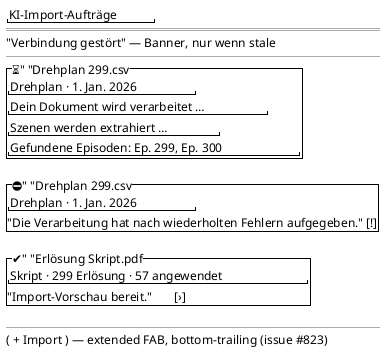
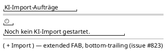
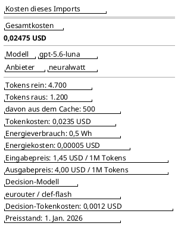

<!-- SPDX-License-Identifier: AGPL-3.0 -->
<!-- Copyright (C) 2024-2026 Breakdown RS Contributors -->
<!-- Co-authored-by: glm-5.3-flash (opencode-go) -->
<!-- Co-authored-by: glm-5.3-flash-flex (neuralwatt) -->
<!-- Co-authored-by: deepseek-v4.1-flash (opencode-go) -->

# AI-Import-Aufträge (ai-import-jobs) — Screen Spec

## Purpose & Context

The persistent "what did I import" surface (issue #547): every AI-import
job the user started stays reachable after leaving the job-status screen.
It closes the silent dead-letter hole — a job that ends in
`dead_letter` or `payload_unavailable` after the user navigated away was
previously unlearnable. The list renders the caller's jobs newest-first
from the cache-then-revalidate `aiImportJobsView` projection.

## Navigation

Reached from the main **Settings** screen's AI section — the
persistent "KI-Import-Aufträge" tile (issue #644): always reachable,
even when zero jobs need attention. Two further paths: the
production-overview **active-jobs summary row** (shown while any known
job needs attention) and, since issue #823, the screen's own **plus
action** (`ai-jobs-plus-fab`), which starts a new import from any list
state. Every push carries `RouteSettings(name:
'ai-import-jobs')`, so the apply outcome's "back to imports"
`popUntil` contract resolves from any entry (the retained path for a
successful apply whose destination could NOT be resolved — see
"Post-apply routing" below). Row selection pushes the job
status screen (`AiJobStatusScreen`) — the screen that owns the single
foreground status watch; back returns to the caller. No route parameters.
AUTHZ-GATE: the jobs list route is ownership-scoped server-side; the
client resolves the authenticated session before the fetch (no session →
no request) and denials surface through code-keyed copy
(`jobWatchForbidden` / `aiJobsLoadError`), never backend `detail`. The
sibling production-overview import entry keeps its block-scope gate —
this screen does not weaken it (it dispatches no block-scoped write); the
plus action only OPENS a sheet, and the submit controller behind it keeps
its own gates.

## Layout

Empty state (same FAB — it is the screen's single create path, which is why
the former CTA is gone):

Expanded (window width class ≥ medium): the same single-column list
constrained to a content max-width with wider gutters — a jobs list never
splits into master/detail panes; the detail surface is the pushed status
screen, on every window size.

## Components & Semantics

| Element | M3 component | Semantics | Copy key |
|---|---|---|---|
| Screen title | Top app bar (`BreakdownAppBar`) | Screen identity (plural) — one line, ellipsized (issue #824: 48 dp header, no extra top inset) | `aiJobsTitle` |
| Plus action (Import) | Extended FAB (`PlusActionFab`, bottom-trailing, key `ai-jobs-plus-fab`) | Issue #823: starts a new import from THIS screen in every list state. Named after what it does (`navAiImport` — „Import"), not the shell's generic „Erstellen", because its sheet carries exactly one entry. Opens the shared quick-create sheet with that single „Import" row, which pushes `AiImportSubmitScreen` on the ROOT navigator (the flow covers the shell). Explicit BUTTON role, visible label, auth-gated (no action for a pending/erroring/signed-out session); the list reserves an 80 dp band plus the bottom system inset (`viewPadding.bottom`, the FAB's own safe margin) so the FAB never covers the last row on a device with a gesture/navigation bar | `navAiImport` + `quickCreateAiImportSubtitle` |
| Job row | List item | Pushes the job status screen (the single-watch owner) | row key |
| Row title | Text | The uploaded document's own file name, at most two lines then ellipsized (issue #763); a job without a name keeps „Drehplan · 1. Jan. 2026" | server `source_file_name`, else `aiJobsRowSubtitle` |
| Row identity line | Text | The imported target once an apply ran: `Skript · 299 Erlösung · 57 angewendet`, `(+n)` for further episodes (issue #763); a named but unapplied row shows `kind · date` here instead, an unnamed one shows nothing (the title already carries it) | `aiJobsRowKindEpisode` / `aiJobsRowEpisodeMore` / `aiJobsRowEpisodeNumber` / `aiJobsRowEpisodeNumberName` / `aiJobsRowApplied` / `aiJobsRowSubtitle` |
| Row status | Text | One of the six honest status copies, always visible next to the icon | `aiImport.jobStatus` |
| Status icon | Icon | Per-status glyph (see glossary); error-colored for terminal failures — reinforcement only, never the sole carrier | status glyphs |
| Retry budget | Text | Retryable `failed` rows show `Versuch {retries} von {maxRetries}` | `aiJobRetryBudget` |
| Row stage | Text | **In-progress** rows (`pending`/`running`) with a published `progress` show the localized extraction stage (issues #664, #763) — a terminal row never does, whatever the fetched row still carries | `aiJobStage*` |
| Row episodes | Text | In-progress rows with discovered episodes show the summary line **with its values** (`Gefundene Episoden: Ep. 299, Ep. 300`) — a label without values never renders (issue #763) | `aiJobEpisodesSeenValues` |
| Row scenes rebuilt | Text | A job whose extraction had to rebuild rows from the document headings states it (`53 Szene(n) nur aus Dokument-Metadaten`, issue #758) — the count comes from `telemetry.scenes_synthesized`, which the Drift cache does not persist, so the line appears with the authoritative read. `0`/absent renders nothing: a clean import is never labelled | `aiJobsRowScenesRebuilt` |
| Last-error indicator | Icon | Presence indicator on rows carrying a server error detail; the raw text renders only on the status screen, as secondary detail | status glyph |
| Stale banner | Banner | Failed refetch serving retained cached rows | `seasonsStaleBanner` |
| Error state | Card + button | Copy keyed on the problem `code`; retry re-runs the list route | `aiJobsLoadError` / `aiJobCheckAgain` |
| Empty state | Icon + text (no button) | Honest "no import yet" narrative. Issue #823 dropped the former `ai-jobs-empty-cta`: the plus action is available in every list state, so a CTA that vanished with the first row was a second path to the same flow | `aiJobsEmpty` |
| Settings AI-imports entry | List item (push, chevron) | Persistent entry from the Settings AI section (issue #644) | `settings.aiImports` + `settings.aiImportsSubtitle` |
| Production-overview summary row | List item | Visible while any known job needs attention (any non-`succeeded` status) | `planningActiveJobRow` / `aiJobsActiveBadge` |

## States

Loading: skeleton rows (visible only before the very first cache seed —
the cached-first paint makes cold starts render rows immediately). Data:
newest-first rows. Empty: honest "no import yet" narrative — no CTA, the
plus action is the create path in every state. Error: full error state when
no rows are retained; a banner above the retained rows otherwise — both
keyed on the stable problem `code`, never `detail`. Stale: the shared
cache-staleness banner when a failed refetch left only cached rows. There
is NO optimistic layer: this boundary dispatches no commands.

## Interactions

Row tap pushes the job status screen, which arms the single foreground
watch (D5) and owns the re-arm (`aiJobCheckAgain`) and preview
(`aiJobReviewPreview`) affordances; leaving it disposes the watch. The
plus action opens the one-entry quick-create sheet and issues no request
itself (issue #823): the sheet pops and the „Import" entry pushes the
submit flow on the root navigator, where the submit controller's own
AUTHZ gate and block-scope gate apply. The
list itself arms NO watch and dispatches nothing — pull-to-refresh
re-runs exactly the list route, which is the status authority for rows;
there is no per-row polling and no fabricated progress indicator (the
wire carries `retries`/`max_retries`, never a percentage; since issue
#664 a running row MAY carry a server-published `progress` stage/chunk
summary — rendered from the fetched row only, never from a client-side
stream or fabricated count, and gated on the row's STATUS so a finished
job cannot advertise the stage it finished at; issue #763). The production-overview summary row and the
Settings AI-imports entry push this screen and never arm a watch — the
SSE stream (`GET /v1/ai-import/jobs/{id}/events`, issue #664) is opened
exclusively by the job status screen while foregrounded.

## Input & Validation

N/A — read-only screen (no forms, no commands).

## Accessibility & i18n

Every row renders its meaning as visible text (file name, kind, date, the
imported episode(s) with their applied counts, status, retry budget, and
for in-progress rows the stage/episode summary); icons reinforce
only and terminal failures additionally use the error color, so color is
never the sole carrier either. All copy via the ARB catalogs (`aiJobs*`,
`jobStatus*`, `jobWatch*`, `aiJobRetryBudget`, `aiJobStage*`); 
backend `detail` text never renders on this screen. Row semantics announce
the title (name or kind + date), the identity/target line and the status.

## Job status — the recorded import target (issue #771)

The job status screen repeats the target the submit screen showed, so an import
is attributable after the fact instead of only being believed. The value comes
from the job row's own snapshot (`AiImportJob.target`) — no second read, no
guessed season.

| Element | M3 component | Semantics | Copy key |
|---|---|---|---|
| Target card | Card (surface container highest) under the status card | `{season} · {block}` from the server-snapshotted `season_number` / `block_number`. A job without a snapshot (pre-#771 row, or a fresh upload whose season read failed) renders the honest, cause-neutral "not recorded" narrative instead of an invented season | `aiImportTargetTitle` / `aiImportTargetLine` / `aiImportTargetNotRecorded` |

## Preview — the target block is attached after extraction (issue #829)

A job uploaded without `X-Active-Block` carries its target **season** and no
block (ADR-039). The preview's block-scope line then carries the actions that
decide it, and nothing else may:

| State | Rendering |
|---|---|
| script states block N, target season has block N | "Aus Skript übernehmen – Block N" → `PUT /v1/ai-import/jobs/{id}/target` |
| script states block N, the season has no block N | "Block N anlegen" → the shared create-block form → attach the created block |
| the script states no block (or the list is unreadable) | "Zielblock wählen" over the target season's blocks, with a create entry |
| attached | the actions disappear; the scope line names the target |
| a preview group already points at an existing episode, or the job was already applied | the locked narrative, no action |

The card renders the summary and these actions **independently**: a block-less
schedule preview has neither a script block nor a target block, so a card that
only appeared next to a summary line would hide the picker — and the apply stays
unavailable without a target.

The freeze is deliberate (design D5): the review-time episode creation writes
real rows into a block, so a later target move would make the apply's cross-block
guard refuse work the reviewer already did. The locked narrative is stated in
every state it holds — an already-applied job as well as a resolved group target,
and next to a script/target mismatch warning — because that is exactly when a
reviewer looks for a way to change the target. The server's own backstop is the
applied-job refusal (`409 ai-import.target-immutable`, `applied: true`); the
client lock is the honest pre-emptive narrative for the state the server cannot
see.

While no target is attached, the apply is unavailable with the localized
`aiImportTargetMissing` copy; the server answers the same state with
`409 ai-import.target-missing` (S1 `season_id`), so two provenances share one
narrative. A raced attach renders the same code with `existing_block_id`, naming
the block that won.

Test keys: `ai-preview-target-attach-script`, `ai-preview-target-attach-create`,
`ai-preview-target-attach-pick`, `ai-preview-target-attach-busy`,
`ai-preview-target-frozen`, `ai-apply-target-missing`.

## Preview & Apply — detected vs extracted scenes (issue #758)

The script preview's subtitle states what the DOCUMENT had, not only what the
model produced, and names the rows that had to be rebuilt because their chunk
returned nothing. Before this, a 57-heading script that produced 4 model rows
rendered as a 4-scene import.

| Element | M3 component | Semantics | Copy key |
|---|---|---|---|
| Script subtitle | Body-small text under the payload title | `{rows} Skript-Szene(n) · {detected} erkannt · {extracted} extrahiert` plus `· {n} aus Dokument-Metadaten ergänzt` when rows were rebuilt. Renders the row count ALONE when `scenes_detected` is `0`/absent (a preview extracted before the counters existed — a ratio is never invented) | `aiPreviewScriptSubtitle`, `aiPreviewScriptReconciliation`, `aiPreviewScriptSynthesized` |
| Rebuilt-row uncertainty | The existing uncertainty notice | Each rebuilt row carries a non-blocking `dropped_row` uncertainty (`field = "extraction"`) from the server, so the apply stays enabled and the missing content is visible row by row | `aiPreviewUncertainty` |

## Preview & Apply — Decision Model star ratings (issue #723)

When the configured Decision Model scored the extraction, the preview
and apply cards render calibrated scores as **1–5 star ratings** via the
shared `AiScoreStars` component (`lib/design/components/`):

| Element | M3 component | Semantics | Copy key |
|---|---|---|---|
| Scene / synopsis / shooting-day score | Icon row (`star` filled vs. `star_border` outline) + label | Machine-evaluated review aid — never a decision; renders NOTHING when the score is `null` (honest absence, no Decision Model / failed pass) | `aiPreviewSceneScore`, `aiPreviewSynopsisScore`, `aiPreviewShootingDayScore`, `aiScoreStarsLabel` |
| Day-group score (apply card) | Icon row on the decision row | Same mapping, aggregated per day group (`DraftShootingDay.score`) | `aiScoreStarsLabel` |
| Low-score filter | `FilterChip` pair above the rows | Narrows the VISIBLE rows to any score `<= 3★` (`< 0.70`); the apply payload keeps every row — filtering is view-only | `aiPreviewFilterAll`, `aiPreviewFilterLowScore` |
| Banner note (scored) | Tertiary banner text | Frames the stars as machine-evaluated under EU AI Act Art. 50; the unscored note (`aiPreviewAiNote`) stays when no score exists | `aiPreviewAiNoteScored` |

The Decision / Scoring Model itself is configured on the AI config screen
(provider + curated model picker, "Use same API key as extraction" toggle,
separate split-billing key field — keys `aiConfigDecision*`); see the
`flutter-ai-config` OpenSpec spec.

## Job status — the cost card (issues #761, #768)

The card was a flat column of equally weighted `bodySmall` lines: the two
facts the user actually wants — **what it cost** and **which model produced
it** — were buried between token counts, snapshot rates, energy figures and a
price date, and the provider was not rendered at all even though
`JobTelemetrySummary.provider` carries it. Since #768 the snapshot also has
more than one priced component (the Decision Model may bill at a different
provider/model) and an explicit `CostTotal` that states whether a sum may be
shown. The redesign therefore promotes a **hero figure** and the
**model/provider identity**, and demotes everything else to icon-prefixed,
grouped detail rows — without dropping a single figure from #675.

The example is deliberately priced in ONE currency, because that is the only
shape in which the card shows a `Gesamtkosten` figure: `0,02475 USD` is exactly
`0,0235 + 0,00005 + 0,0012`. When the components are priced in DIFFERENT
currencies, or one of them is unpriced, the server refuses the sum and the hero
degenerates to the priced component under a component label plus the refusal
note below it (see the table) — the card NEVER adds or converts currencies to
produce a total the backend did not publish.

Compact (window width class < medium): the same card, one column — the
identity chips wrap instead of shrinking (`Wrap`), and a long curated model id
breaks onto a second line and is then ellipsized (full value in a tooltip), so
nothing overflows at 360 dp. Nothing is fixed-width.

| Element | M3 component | Semantics | Copy key |
|---|---|---|---|
| Card header | Icon + `titleMedium` row (`receipt_long_outlined`, `surfaceContainerHighest` card, `AppSpacing` padding) | Titles the card; the icon reinforces only | `aiJobCostTitle` |
| Hero figure | `headlineMedium` (bold) under a visible `labelLarge` label | The number the user pays — resolved ONCE for both surfaces by `costPrimaryFigure`: `cost.total` when the wire publishes one (`known`), otherwise the extraction token cost; with `cost_display_preference = energy` the energy figure (`effective_capped_nano`, i.e. the capped value — never the raw one). The label is ALWAYS rendered and changes with the figure (`Gesamtkosten` / `Tokenkosten` / `Energiekosten`), so a component is never dressed up as the total. No inline preference switch: the preference is a settings value, and the job screen does not write settings | `aiJobCostHeroTotal`, `aiJobCostHeroToken`, `aiJobCostHeroEnergy` |
| Refused total | Tertiary icon + `bodySmall` note directly under the hero | Renders only when `cost.total.status` is `incomplete` (a recorded component is unpriced) or `mixed_currency` (design D2 forbids a conversion): the priced component shows, and the note states WHY the sum is absent — under BOTH preferences, since the refusal is a fact about the snapshot, not about the figure the user chose to see first. `unknown` and an absent total (every pre-#768 row) render NO note — an absence is not an error | `aiJobCostTotalIncomplete`, `aiJobCostTotalMixedCurrency` |
| Model chip | Labelled chip (`smart_toy_outlined`) in a `Wrap` | The model that produced the rows (`telemetry.model`), two lines max, ellipsized, full value in a tooltip. The visible label "Modell" carries the meaning | `aiJobCostModelLabel` |
| Provider chip | Labelled chip (`cloud_outlined`) in the same `Wrap` | The provider (`telemetry.provider.name`) — newly visible in #761; also two lines max + tooltip | `aiJobCostProviderLabel` |
| Usage rows | Icon + `bodySmall` (`input` / `output` / `cached`) | The extraction component's counts; the cached row renders only when `cached_tokens_in > 0`. They survive an `unknown` price — an unpriced model still states its consumption | `aiJobCostTokensIn`, `aiJobCostTokensOut`, `aiJobCostCachedTokens` |
| Component costs | Icon + `bodySmall`, the preference-selected row bold | Token cost (`payments_outlined`) and the energy block — consumption, energy cost and the Extraction/Decision energy prices all use `bolt_outlined`, so the energy rows read as one group. The hero is always reconstructable from the rows below it, and the rows never contradict it | `aiJobCostTokenTotal`, `aiJobCostEnergyTotal`, `aiJobCostEnergyConsumption`, `aiJobCostEnergyCapped` |
| Snapshot rates | Icon + `bodySmall` (`price_change_outlined`) | The rates frozen into the snapshot — never a live lookup | `aiJobCostRateInput`, `aiJobCostRateOutput` |
| Decision component | Group: icon + `labelLarge` header (`auto_awesome_outlined`), then the component's OWN `provider / model`, its own usage counts and its own priced figures; an unpriced component keeps its counts and says it is not priced | Issue #768: the Decision Model may be a DIFFERENT provider/model than the extraction model, so its usage and rates are its own. An unpriced component never borrows the extraction rate and never renders `0` | `aiJobCostDecisionTitle`, `aiJobCostDecisionTokenTotal`, `aiJobCostDecisionEnergyTotal`, `aiJobCostDecisionUnpriced` |
| Image component | Icon + `bodySmall` (`image_outlined`) | The #673 slot. Always absent for text imports, but it is priced INTO `cost.total`, so a rendered total must stay explainable by the rows around it | `aiJobCostImageTotal` |
| Price date | Icon + `bodySmall` (`event_outlined`) | `price_as_of` — a compliance-ish fact, not decoration; it stays visible | `aiJobCostPriceAsOf` |
| Decision outcome | Unchanged `AiDecisionOutcomeText` (issue #767) under the rows | Silent when the job recorded no outcome | `aiDecisionRan` etc. |
| Unknown price | Hero label + localized "Unbekannt" as the hero VALUE (`ai-job-cost-unknown`) | `cost.status == unknown` (e.g. a local Ollama run): no fabricated `0`, no currency figure; the usage rows and identity chips still render | `commonUnknown` |
| Nothing billed | Header + `bodySmall` narrative (`ai-job-cost-not-applicable`) | `cost.status == not_applicable` (native CSV schedule): states that no AI model was billed instead of showing an unknown or zero price | `aiJobCostNotApplicable` |

The **compact jobs-list line** (`aiJobCostCompactCopy`) keeps its single-line,
zero-extra-request behaviour and renders the SAME primary figure as the card
(both call `costPrimaryFigure`, so the total-aware rule cannot drift between the
surfaces); it gains only the metric glyph of the same preference
(`payments_outlined` / `bolt_outlined`, `help_outline` for unknown,
`money_off_outlined` for nothing-billed), resolved by ONE helper
(`aiJobCostMetricIcon`). A cached row carries `cost: null`, so the line (and its
glyph) is simply absent until the authoritative list read refreshes it.

Everything the card shows comes from the job the screen already holds (`cost`
snapshot + `telemetry` + `decision_telemetry`): no second projection read, no
extra request, and the single SSE consumer stays the job-status controller
(battery contract D5). All cost math is the integer nano-currency formatting of
`cost_format.dart` — no floats, and a non-zero amount never renders as `0`.

## Preview, job status — the Decision Model outcome (issue #767)

A configured Decision Model that produced no stars had no explanation: "no
model configured", "the client could not be built", "the scoring call failed"
and "the provider answered partially" all rendered the same empty space. The
backend now records the outcome on the job (`AiImportJob.decision_telemetry`)
and every affected row carries `DecisionRubric.scoring_failed`; both surfaces
render it, and neither ever fabricates a rating.

| Element | M3 component | Semantics | Copy key |
|---|---|---|---|
| Effective Decision Model (preview header) | Icon + body-small line under the naming header card (`auto_awesome_outlined`, `onSurfaceVariant`) | Names the `provider / model` that actually scored the import — the model behind the stars, which is NOT the extraction model of the header card above. A pair the wire carries only partially degrades to the part it has | `aiDecisionRan`, `aiDecisionModelUnnamed` |
| Ran without a model (preview header, job cost card) | Icon + body-small line (`info_outline`, tertiary) | States that no Decision Model was configured — distinguishable from the `client_unavailable` copy, which names the CONFIGURED pair the worker resolved. A native CSV schedule or a pure merge renders the "no scoring needed" variant | `aiDecisionSkippedNoConfig`, `aiDecisionClientUnavailable`, `aiDecisionSkippedNotApplicable` |
| Scoring failed (preview header, job cost card) | Icon + body-small line (`report_outlined`, error) | Names the failure and the number of affected rows from `decision_telemetry.failed_rows` (ICU plural, de + en). The rows that did score keep their stars | `aiDecisionScoringFailed` |
| Outcome not recorded | — (renders nothing) | A pre-#767 job carries no outcome; the client renders NO line rather than a guessed class. Same arm for an unrecognized future `outcome` value (neutral `aiDecisionNotRecorded` copy) | `aiDecisionNotRecorded` |
| Outcome read failed (preview header) | Icon + body-small line (`report_outlined`, error) + text button | A failed job snapshot is NOT the silent arm above: the provider surfaces it as `AsyncError` (AGENTS.md §4, "no silent discard"), so the line says the outcome could not be read and offers the retry that re-reads the job. No automatic backoff retry — the refetch is user-driven | `aiDecisionUnavailable`, `commonRetry` |
| Row whose scoring failed | Icon + body-small line inside the row card (`report_outlined`, error) | Rendered when `DecisionRubric.scoringFailed` is true: the row states why it has no stars. A row WITHOUT a rubric (the pass never ran) renders nothing extra — the note names a failure, not an absence | `aiPreviewScoringFailed` |

The outcome is read with ONE snapshot `GET /v1/ai-import/jobs/{id}` (preview
header) or from the job the screen already holds (cost card); the job-status
controller stays the app's only SSE consumer (battery contract D5).

The snapshot read has three outcomes, and the design keeps them distinct:
an `Ok` job yields a line (or none, when it recorded no outcome), while a
failed `GET` yields the unavailable line with the retry — never the silent
"no outcome" arm. The job-status cost card renders from the job it already
holds, so a read failure never reaches it.

## Preview — provider/model header and the Decision Model disclosure (issue #760)

The preview's provider/model statement was one `bodySmall` line wedged between
the app bar and the scene cards, so in a long preview the machinery that
produced the rows was effectively invisible; and a configuration WITHOUT a
Decision Model ran silently, which made the absent Pass-2 continuity
suggestions and the absent star ratings look like a defect instead of a
configuration state.

| Element | M3 component | Semantics | Copy key |
|---|---|---|---|
| Provider/model header | Card (`surfaceContainerHighest`) as the FIRST child of the preview list, above the payload banner | Model as the primary line (`titleSmall`, ONE line, ellipsized — a curated id never pushes the rows off screen), provider as the secondary line (`labelLarge`), and the unchanged EU AI Act Art. 50 sentence as the caption, so promoting the facts does not weaken the disclosure. Shared with the submit/apply surfaces through ONE resolution (`aiNamingSentence`), so the wording cannot drift. The leading `memory_outlined` glyph reinforces only — the visible text carries the meaning. **Since issue #831 this card names the pair the JOB ran with** — see the next section | `aiNamingLine`, `aiPreviewNamingUsed`, `aiPreviewNamingConfiguredDiffers` |
| Honest degradation | The same card, one line | No job telemetry (an old job) or an unreadable job snapshot → the card cannot name a used pair, so it names the **configured** pair ONCE in the explicit "currently configured" wording and invents no comparison. Unconfigured account OR failed discovery (and no used pair) → the existing "no AI configuration" copy; pending discovery → the loading note. A reload keeps the last resolved naming (`skipLoadingOnReload`) | `aiNamingLine`, `aiDisclosureNamingBodyUnconfigured`, `aiDisclosureNamingBodyLoading` |
| No Decision Model configured | Non-blocking card (`tertiaryContainer`) under the outcome line, directly above the payload/apply section | Renders ONLY for a RESOLVED configuration whose `decisionProvider`/`decisionModel` are unset. States the two factual consequences — Pass-2 wardrobe continuity suggestions and the scene/synopsis ratings are skipped — and that the import still runs. The action opens the AI configuration screen; the apply is never blocked. A pending discovery, an unconfigured account and a FAILED read render nothing (a failed read is not the fact "unset"). One instance only: the apply section sits in the same scroll view directly below, so a second card at the dispatch point would duplicate UI, not information | `aiPreviewDecisionModelWarningTitle`, `aiPreviewDecisionModelWarningBody`, `aiPreviewDecisionModelWarningAction` |

The Decision Model state comes from `configuredAiNamingProvider` — the caller's
newest non-revoked configuration, i.e. the same configuration the import
handler resolves — so no extra endpoint, no extra call (one cached discovery
per container), and no warning about somebody else's config.

## Preview — the USED provider/model pair, not the configured one (issue #831)

The reported defect: the header named the currently configured `AiConfigView`
as its primary line, its provider beneath it, and then repeated the same pair
in the caption — the configured model twice and the model that actually
produced the rows never. The identity was on the wire all along, content-free:
`AiImportJob.telemetry` (`provider` / `model`), the same pair the job cost card
renders as identity chips.

| Element | M3 component | Semantics | Copy key |
|---|---|---|---|
| Used pair (primary) | Text in the header card (`titleSmall`, ONE line, ellipsized) | `Verwendetes Modell: {pair}` where the pair joins the wire values as `model (provider)` (only the half the wire carries; never an invented name). Sourced from the job's telemetry snapshot (`aiJobTelemetryProvider` → `getJobAndCache`, NOT the SSE watch, never the configuration) | `aiPreviewNamingUsed` |
| Configured pair (secondary) | Text in the header card (`bodySmall`, `onSurfaceVariant`) | `Derzeit konfiguriertes, abweichendes Modell: {pair}` rendered ONLY when the configured pair differs from the used one by provider or model. Equal configurations render NO second line — the pair is named once | `aiPreviewNamingConfiguredDiffers` |
| Unconfigured account with a used pair | The primary line alone | A deleted/changed configuration does not undo the import that already happened: the job's used pair still renders, and no comparison is claimed | `aiPreviewNamingUsed` |

The comparison is field-wise over the KNOWN telemetry halves: a wire value
carrying only the provider never claims the configured model differs (the used
model is simply unknown), and vice versa. A half-empty "differs" claim is
exactly the invented comparison this card must not make. Both facts are pure,
Tier-1 testable (`aiNamingPairLabel`, `aiNamingComparison`). Both header lines
are bounded to ONE ellipsized row, so a long curated model id never wraps the
header and pushes the review rows down.

## Preview — the episode picker lives with the missing-context notice (issue #831)

`Episode wählen…` (`aiApplyPickEpisode`) used to render UNCONDITIONALLY below
`Import anwenden`, so it read as a stray control on the normal path — the apply
context is normally resolved by `aiJobContextProvider` plus the in-preview
episode creation long before the review. The affordance now renders ONLY in the
missing-context branch, next to the notice that explains it
(`ai-apply-context-missing`), so the `state.context == null` recovery is never
orphaned and nothing sits under the submit button once the context is resolved.
The test key (`ai-apply-pick-episode`) moved with the affordance.

## Preview & Apply — outfit provenance and wardrobe gaps (issue #745)

Pass 2 of the AI import (`ai-import-decision-outfit-continuity`) attaches
looks the script never spelled out. The preview states where each look came
from, and a scene whose figure the script left undressed offers ONLY the looks
the script supports:

| Element | M3 component | Semantics | Copy key |
|---|---|---|---|
| Outfit provenance | Pill badge (`tertiaryContainer`) above the look's evidence line | Exactly ONE label per `DraftOutfit.origin`: quoted / derived (Pass 1) or continued-from-scene-N / inferred-from-context (Pass 2). An absent origin (pre-#745 stored preview) and an unrecognized future value render NOTHING — provenance is never invented. The reference scene number comes from `DraftOutfit.provenance.source_scene_number` | `aiPreviewOutfitOriginExplicit`, `aiPreviewOutfitOriginDerived`, `aiPreviewOutfitOriginContinued`, `aiPreviewOutfitOriginContinuedNoScene`, `aiPreviewOutfitOriginInferred` |
| Source quote line | Body-small text under the badge | Rendered ONLY for a Pass-1 look. A Pass-2 look has no chunk to quote (the server leaves `source_quote` empty), and an empty quote line would read as if the script had stated the look | `aiPreviewOutfitQuote` |
| Wardrobe-gap card | Card with a `ChoiceChip` per candidate + a leave-empty chip | Replaces the plain uncertainty notice for a `dropped_row` uncertainty on `outfits` whose `candidates` the script supports. Default = leave empty (the script-grounded state); each chip carries the candidate's look name and the server's confidence. A gap WITHOUT candidates keeps the plain notice — an invented option is never on offer | `aiPreviewContinuityGapTitle`, `aiPreviewContinuityGapPrompt`, `aiPreviewContinuityCandidateContinued`, `aiPreviewContinuityCandidateInferred`, `aiPreviewContinuityCandidateConfidence`, `aiPreviewContinuityKeepEmpty` |
| Gap summary (apply card) | Body-small line per gap, under the day summaries | EU AI Act review gate: the dispatch point states which look each gap scene will wear — or that it deliberately stays without one | `aiApplyContinuityGapPicked`, `aiApplyContinuityGapLeftEmpty` |
| Stale pick refusal | Error line in the apply card | `409 ai-import.apply-unknown-continuity-candidate` (the preview no longer offers the pick): refresh the preview and re-apply — the client never re-derives a selection the server refuses | `aiApplyErrorUnknownContinuityCandidate` |

The pick travels as `continuity_selections` on the apply request. Its
`character_identity` is the preview-wide matching key (case-folded,
whitespace-collapsed character name), derived in
`lib/features/ai_import/import_jobs/continuity_gap.dart` from the gap
uncertainty's own scene: the client pairs the uncertainty with the scene's
undressed figure by resolving the continuation candidate's `source_draft_ref`
back to the row that dresses that figure — never by parsing the server's note
prose. A picked candidate counts as a review edit, so `accept_as_is` stays a
truthful statement about the review.

## Post-apply routing and refresh (issue #759)

Applying a preview used to end the flow in place: the outcome card rendered on
the review screen and the only way out was back to the imports list, while the
imported episode and its scenes stayed invisible until the app was restarted.
The apply now lands the user on the imported material.

| Element | M3 component | Semantics | Copy key |
|---|---|---|---|
| Destination | — (navigation) | On success: sticky episode scope ← the episode the reviewer targeted (`episode_id` of the apply request; the response's biggest contribution when that one is absent), its block scope cascaded from the same seam, active season ← the import's season (only written when it differs), destination ← **Script**, then the import stack is popped. Landing also resets the destination's own nested navigator to its root route | — |
| Unresolved destination | Body-small error line inside the outcome card | A SCRIPT apply that named episodes but whose target cannot be resolved honestly (the season is not in the read cache, or the episode number is neither on the wire nor in the block's cached rows) keeps the review screen with the FULL outcome and says why it did not move. No half-navigation, no invented number, no network read on the navigation path. A **schedule apply** names no episode at all — it merges onto the project's existing scenes and days — so it keeps the outcome card WITHOUT this line: a claim about an episode that does not exist would be noise | `aiApplyNavigationUnresolved` |
| Report at the destination | Dismissible card (`primaryContainer`) at the top of the Script view, detail area capped at 45 % of the viewport and scrollable (the card is a non-flex `Column` child, so an unbounded card would starve the script list on a long report) | The review's outcome must survive the navigation: applied counts, skipped day groups, every `unapplied_outfits` row with its reason, and the OTHER episodes of a multi-episode document with their row counts (the episode scope hides those rows, so naming them is the only thing that keeps the user from believing the import stopped at the episode that opened) | `aiPostImportReportTitle`, `aiPostImportReportDismiss`, `aiPostImportReportOthersTitle`, `aiPostImportReportOtherEpisode`, `aiApplyOutcome`, `aiApplyOutcomeScript`, `aiApplyUnappliedOutfit`, `aiApplySkippedDayGroups` |
| Post-apply refresh | — (cache invalidation) | `episodesListFetch` + `blocksListFetch` (issue #666, retained), `scenesListFetch` for every episode the response names (the whole family for a response that names none), their TTL staleness memos, and the season-script composition. Without it the Script view — mounted for the whole import in the shell's `IndexedStack` — served a pre-import projection until the TTL expired | — |

The progress surface of the run itself is issue #762's staged apply stream
(`GET /v1/ai-import/jobs/{id}/apply-events`): an indeterminate bar before the
first frame, then the determinate row counter with its stage line and a coarse
ETA — no fabricated percentage, no animation-only feedback.

## Apply — a blocked run: live or abandoned (issue #805)

`409 ai-import.apply-in-flight` means another run of this job owns the progress
slot (#800). Before #805 the client could only say that something is in flight
and wait, so a run whose API process had died kept the slot (its payload reads as
live until `ApplyProgress::STALE_AFTER`, 10 min) and the reviewer saw a frozen
progress card plus the generic "outcome unknown" error — with no way forward
except restarting the app. The refusal now carries the two facts that turn the
block into a decision (S1 extensions, both server-measured):

- `apply_run_age_seconds` — how long the owning run had been silent at the
  moment of the refusal. Measured from the run's last published frame, or — when
  it has published none — from the job row stamp the claim itself wrote (issue
  #863), which is the same column the server's steal predicate judges that state
  by. So a run that died before its first frame is ageable too, and the client's
  "abandoned" verdict cannot disagree with the server's steal. **Absent** only
  when the slot reports no timestamp at all (a pre-#863 server): no age exists,
  and `0` would claim "just published".
- `stale_after_seconds` — the server's own staleness window
  (`ApplyProgress::STALE_AFTER`). Sent, never mirrored client-side.

`age <= window` ⇒ **live**; `age > window` ⇒ **abandoned by the server's own
predicate** (strict: the claim steals only a payload OLDER than the window, so at
exactly the window the run is still protected). `age` unknown ⇒ **unaged**: the
slot named no timestamp at all (a pre-#863 server), so the card names that
instead of inventing an age or a verdict. Since #863 an owner that publishes no
progress is no longer one of those cases — it is aged by the claim's own row
stamp, so the takeover affordance is reachable after the window for a run that
died before its first frame, not only for one that published and then went
silent. The card is not an error card: nothing failed, and
the copy names what blocks and what the user can do.

| Element | M3 component | Semantics | Copy key |
|---|---|---|---|
| Live blocking run | Body-small text inside the apply card, above the submit button (`ai-apply-in-flight-live`) | Names the run's own last publication (`letzte Meldung vor 3 min`) — server-measured age plus the elapsed time since receipt. The submit button is DISABLED while the run is inside the server's window: a second dispatch could only be refused again. Never a takeover affordance here | `aiApplyInFlightLive` |
| Takeover countdown | Body-small text under the live line (`ai-apply-in-flight-countdown`) | Whole minutes until the server's window has passed, rounded UP (never "0 min" next to a live run). Ticks locally once a second — no polling request, because the server would answer the same refusal until the window passed | `aiApplyInFlightTakeoverIn` |
| Abandoned run | Body-small text (`ai-apply-in-flight-stale`) + hint + explicit action | The blocking run published nothing for longer than the window. The hint states that already-applied rows are skipped, because the takeover is the same idempotent apply | `aiApplyInFlightStale`, `aiApplyInFlightStaleHint` |
| Unaged blocking run | Body-small text + hint (`ai-apply-in-flight-unaged`) | The slot reported no timestamp at all (a pre-#863 server, which could only age a published payload), so there is no age to compare. The card claims neither liveness nor abandonment, shows no countdown, and leaves the apply action available — the server's claim decides. Without this state such a refusal would disable the apply forever | `aiApplyInFlightNoAge`, `aiApplyInFlightNoAgeHint` |
| Takeover | `TextButton` (`ai-apply-in-flight-takeover`) | The **explicit** way out: re-dispatches the apply, no second confirmation dialog (this card IS the confirmation), no app restart. The server's claim steals the abandoned slot in the same statement. Never automatic — a live run may be this person's other device, so a blind re-dispatch stays forbidden. The button obeys the normal apply preconditions (review acknowledgement, resolved target) and is disabled while a dispatch is out | `aiApplyInFlightTakeover`, `aiApplyInFlightCheckAgain` |
| Settled run | — (stream listener) | The card outlives the `POST`, so the countdown is a bound, not the truth: the apply-run stream's final `null` frame (`AiApplyRunFinished`) clears the notice the moment the blocking run ends, and a **progress** frame re-anchors the local silence to that arrival — a run that keeps publishing can never be labelled abandoned by a countdown started earlier (the anchor is the frame arrival, not the payload's server timestamp, so no two clocks are compared). `AiApplyRunIdle` deliberately does NOT clear it — `apply_progress: None` is "no progress published", never "idle" | — |

Decisions in the data layer, not the widget: a refusal naming an **abandoned**
run stops the reconciliation loop at once (one dispatch, then the user's
decall); a **live** refusal keeps the bounded budget (#800's ambiguous-timeout
case — the client's own earlier POST may still be running) and a budget that
ends there is reported as `ApplyInFlight`, never as `ApplyUnresolved`. A server
that sends no window (pre-#805) keeps the exact previous wait behaviour: the
client never guesses a policy it was not told.

## Tests

Widget tests (issue #823): the screen's plus action renders for a resolved
session (button role, visible „Import" label), opens a sheet with exactly
one runnable entry and pushes `AiImportSubmitScreen` on the root navigator;
the empty state renders its narrative WITHOUT a CTA; a signed-out session
renders no plus action. Goldens: {light,dark}×{android,macos} for the list
and the cost rows (the FAB is part of both baselines).

Widget tests (issue #759): a successful apply with a scripted repository
leaves the preview, selects the Script destination with the imported episode
in scope, publishes the report (additional episodes named) and re-runs the
scene + season-script seams (counting overrides); a partially applied response
keeps its `unapplied_outfits` reachable at the destination and dismisses; a
report resets the destination's nested navigator to its root; an unresolvable
destination (no applied episode / uncached season) keeps the review screen
with the outcome card and the explicit hint, with the scopes untouched. Unit
test: the target choice (reviewer's episode, biggest contribution, server-order
ties, schedule apply → none).

Widget tests: a row carrying `DecisionRubric.scoringFailed` renders the failure
note inside its card and NO stars, a scored row renders stars and no note, and a
row without a rubric renders neither (issue #767); the preview header and the
job cost card name the recorded outcome and stay silent for a job without one;
unit tests cover every outcome class in de + en including the `scoring_failed`
plural. Widget tests (issue #760): the preview header is a `Card` above the
payload rather than a `bodySmall` line, a long model id stays on one line and
ellipsizes without an overflow, the "no Decision Model" card renders exactly
for a configured-but-empty Decision Model slot and leaves the apply reachable
after the review acknowledgement, and both the unconfigured account and a
failed discovery fall back to the "no AI configuration" copy with no warning
(never a claim the app did not read). Widget tests (issue #831): the header
names the USED pair from the job telemetry with the configured pair beneath it
ONLY when the two differ; an equal configuration renders one line; a job
without telemetry (and a failed telemetry read) names no used pair and claims
no comparison; a used pair survives an unconfigured account; the apply card
renders `ai-apply-pick-episode` only while the context is missing; and the
submit affordance stays disabled until a document is picked (see
`ai-import-submit.md`). The AI-naming trajectories for the preview goldens
configure a Decision Model, so the warning stays out of them. Widget tests: the degraded-extraction row line renders for `scenes_synthesized > 0`
and stays absent for a clean run (issue #758); the script preview subtitle
states detected vs extracted and names the rebuilt rows, and keeps the row
count alone for a pre-#758 payload; rows render kind + date + status text + icon; tap pushes the
status screen (watch-call proof: zero before the tap); empty state + CTA;
error state per `code`; stale banner over retained rows; terminal-failure
distinctness; production-overview summary row visible/hidden matrix and
navigation; Settings AI-imports entry push + back-to-Settings contract
(issue #644).
Unit tests: cache-then-revalidate ordering, no-watch assertion (D5),
remembered-id fast-path seed ordering, `forgetJob` reconciliation, status
label matrix (all six), code-keyed error copy. Goldens:
`ai_jobs_light_android`, `ai_jobs_dark_android`, `ai_jobs_light_macos`,
`ai_jobs_dark_macos`. Tier-4 integration is deliberately not added (the
tier-2 tests cover the return path with a mocked API; recorded decision).
