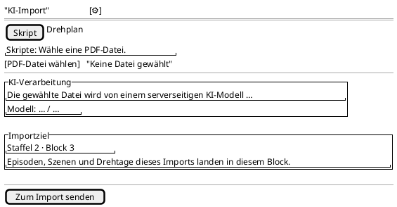

<!-- SPDX-License-Identifier: AGPL-3.0 -->
<!-- Copyright (C) 2024-2026 Breakdown RS Contributors -->
<!-- Co-authored-by: glm-5.3 (neuralwatt) -->

# AI-Import-Ziel (ai-import-submit) — Screen Spec

## Purpose & Context

The submission surface of the AI import: pick the document kind, pick the
file, state the AI disclosure and dispatch the upload. Since issue #771 it also
states — and resolves — the **write target**: the season and block the imported
episodes, scenes and shooting days will land in. Before that, the target was
ambient `X-Active-Block` state that the screen never named, so a user who
created a new season to isolate an import round saw the rows land in the
previous season.

## Navigation

Reached from four entries, all pushing with `RouteSettings(name:
'ai-import-submit')`: the season home's empty-state CTA (`SeasonsScreen`), the
season-setup wizard's completion CTA (which passes the CREATED `seasonId`), the
quick-create sheet, and the production overview. Back returns to the caller. The
AUTHZ-GATE runs before any protected call: the season piece-department
capability is resolved client-side and a denial renders the localized 403
narrative with **zero** requests issued.

## Location & Context

The shell's location strip and scope chip own the ambient scope. This screen
adds the *explicit* target surface (below) because the scope pill is not
necessarily on screen on every entry path, and because the wizard's freshly
created season is not yet the ambient scope.

## Layout

The target card also renders two other static shapes: the **block picker**
(title + one selectable row per block of the target season) and the **blocked**
state (a single explanatory line, submit disabled). Expanded (window width class
≥ medium): the same single column, constrained to a content max-width — the
form never splits into panes.

## Components & Semantics

| Element | M3 component | Semantics | Copy key |
|---|---|---|---|
| App bar title | Top app bar | Screen identity | `aiImportTitle` |
| Configure action | Icon button (top app bar) | Opens the AI configuration | `aiImportConfigure` |
| Kind picker | Segmented button | Script vs. schedule; the pending file is cleared on a switch (a carried-over body would upload under the wrong declared content type) | `aiImportScript` / `aiImportSchedule` |
| Kind hint | Body text | Names the accepted file types for the picked kind | `aiImportScriptHint` / `aiImportScheduleHint` |
| File row | Outlined button + text | Picks the document; the picked name renders beside it, `Keine Datei gewählt` otherwise | `aiImportPickPdf` / `aiImportPickCsvPdf` / `aiImportNoFile` |
| AI disclosure card | Card (tertiary container) + `smart_toy_outlined` icon | EU AI Act Art. 50 point-of-interaction disclosure, **above** the submit action, plus the configured provider/model naming line (degrading honestly when unconfigured) | `aiImportDisclosureTitle` / `aiImportDisclosureBody` |
| Target card | Card (surface container highest) | The write target of this import — the one fact that decides where every imported row lands. Rendered directly above the submit action, beside the disclosure | `aiImportTargetTitle` |
| Target line | Title-medium text | `{season} · {block}` from read DTOs only: the season number is resolved **cache-only** and degrades to `Staffel unbekannt`; the block number comes from the resolved scope and degrades to `Block unbekannt`. Never a fabricated number | `aiImportTargetLine` with `blockSeasonNumber` / `blockTileLabel` / `aiImportTargetUnknownSeason` / `aiImportTargetUnknownBlock` |
| Target hint | Body-small text | States the consequence ("episodes, scenes and shooting days land in this block") so the target is actionable, not decorative | `aiImportTargetHint` |
| Target picker | List items in the target card | Shown when the target season has **several** blocks: exactly one row per block, tapping adopts it as the sticky scope (the header then follows the line) | `aiImportTargetPickBlock` + `blockTileLabel` |
| Target blocked state | Body text | No block in the season → "create a block first"; no season context → "select a season first". Both disable the submit action | `aiImportTargetNoBlocks` / `aiImportTargetNoSeason` |
| Target retry | Text button | The block-list fetch failed: retry re-runs the season's block fetch, error copy keyed on the problem `code` | `blocksFetchError` + `commonRetry` |
| Submit action | Filled button | Dispatches the upload; **disabled** while no target is resolved (loading, pending pick, no block, fetch failure) | `aiImportSubmit` |
| Upload progress | Linear progress indicator | Indeterminate only — the wire carries no percentage | — |

## States

Loading: the target card states `Importziel wird ermittelt …` and the submit
action is disabled. Data: the target line (or the picker, when the season has
several blocks) plus the hint. Empty (no block): the "create a block first"
line, submit disabled. Empty (no season): the "select a season first" line,
submit disabled. Error: the block-list fetch failure renders its code-keyed copy
with a retry affordance, submit disabled. Optimistic: none — the screen
dispatches one command (the upload) and hands the projection reconciliation to
the job status screen.

## Interactions

Kind switch clears the pending document. File pick reads the bytes immediately
(nothing persists client-side beyond the in-flight upload). A pick in the
multi-block picker writes the sticky scope, which cascades into the
`X-Active-Block` header and the visible line at once — no manual pill switching.
Submit resolves the target first (one block → adopted automatically, several →
picker, none → blocked), then runs the AUTHZ-GATE, then dispatches the upload
with the declared season (`X-Declared-Season`). If the active block belongs to a
**different** season than the resolved target, the dispatch is refused
client-side with `ai-import.scope-mismatch` and zero requests — the server
answers the same code when a declaration contradicts the header, so one
narrative covers both provenances. A failed dispatch stays on the screen with a
code-keyed snackbar; a 202 opens the job status screen, a 200 opens it with the
duplicate callout.

## Input & Validation

No free-text fields. The dispatch guards, in order: no document → `aiImportDocMissing`
snackbar with zero calls; no season context → client code `ai_import.scope_missing`;
target season ≠ active block's season → `ai_import.scope_mismatch` (409); gate
denial → the gate's own code (`membership.pending` / the capability code); the
script route with a non-PDF source → `ai_import.unsupported_media_type` (415,
client-side, zero calls). Every server failure surfaces keyed on its stable
`code` (`http.payload-too-large`, `ai-import.unsupported-media-type`,
`ai-import.forbidden`, `ai-import.disabled`, `ai-import.scope-mismatch`).

## Accessibility & i18n

The target line is the primary label of the card and is announced as one
semantics node with the title, so a screen-reader user hears "Importziel,
Staffel 2, Block 3" before reaching the submit button. The submit action always
carries a visible label (glossary rule); the disabled state is a real
`onPressed: null` (announced as disabled, not merely dimmed). All copy comes
from the ARB catalogs (`aiImport*` keys); backend `detail` text never renders.
The target card uses theme colors only (`surfaceContainerHighest`), no inline
styles.

## Tests

Widget tests (`test/features/ai_import/import_submit_screen_test.dart`): the
target line renders season + block above the submit action; a wizard entry with
exactly one block adopts it and the dispatch declares that season; several
blocks render the picker, keep the submit disabled, and a pick publishes the
line and adopts the scope; a season without blocks and a screen without a season
context both block the upload with actionable copy. Controller tests
(`test/features/ai_import/import_jobs_test.dart`): a target season the ambient
block does not belong to is refused with `ai_import.scope_mismatch` and zero
repository calls; a matching season dispatches and declares it. Repository
tests (`test/unit/ai_import_repositories_test.dart`): the declared season rides
as `X-Declared-Season` on both upload routes and is absent when no target was
resolved. Job view: `test/features/ai_import/job_status_screen_test.dart`
asserts the recorded target line and the honest "not recorded" arm for jobs
uploaded before the field existed (goldens re-baselined with the target card).
