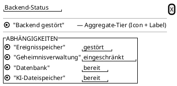

<!-- SPDX-License-Identifier: AGPL-3.0 -->
<!-- Copyright (C) 2024-2026 Breakdown RS Contributors -->
<!-- Co-authored-by: deepseek-v4.1-flash (opencode-go) -->

# BackendHealthDetail — Screen Spec

## Purpose & Context
The dependency breakdown behind the account drawer's backend health pill
(issue #730). The pill (#657) only names the coarse tier
(„Backend gestört"); this surface answers *which* dependency the backend
reports as broken, so a user seeing stale reads or failing commands can
tell "device offline" from "the event store is down" without reading
server logs. Used by every signed-in user; especially valuable for beta
testers running a dev stack where one missing sidecar flips the whole
report.

## Navigation
A **modal bottom sheet**, opened by tapping the health pill at the top of
the account drawer (#653). The drawer deliberately **stays open**
underneath: the pill is the health controller's only keeping-alive
listener (autoDispose, #657 battery rule), so popping the drawer first
would stop the poll loop and blank the data. Dismissing the sheet (close
button, barrier tap, swipe down) returns to the open drawer. No route
parameters. AUTHZ-GATE: the sheet issues **no** request of its own — it
renders the probe results the pill's controller already holds, and
`GET /v1/health` is public (the backend exempts it from auth by design),
so no client-side membership check applies.

## Location & Context
N/A — the sheet is a status surface, not a planning-hierarchy surface. It
is opened from the shell-level drawer without a `PlanningLocation`
argument; the location strip and scope chip stay hidden
(graceful-degradation rule).

## Layout

Variants: the list is replaced by an explanatory paragraph when the tier
is `offline` („Backend nicht erreichbar" + re-check note) or when the
server reports a tier without entries, and by a „Status wird abgefragt …"
line while the first probe is still in flight. Long labels wrap; the
sheet scrolls rather than clipping.

## Components & Semantics
| Element | M3 component | Semantics | Copy key |
|---|---|---|---|
| Sheet | Modal bottom sheet (root navigator) | Dismissible overlay; barrier tap / swipe down close | — |
| Title | Sheet headline | Surface identity | `health.detail.title` |
| Close affordance | Icon button | Dismisses the sheet (same as barrier tap) | `common.close` |
| Aggregate row | Status row (icon + label) | One merged announcement of the tier — the same vocabulary and semantic status tokens the pill uses | `health.pill.healthy` / `.degraded` / `.unhealthy` / `.offline` |
| Dependency rows | Status rows in a labeled group | One merged announcement per row, „\<dependency\>: \<status\>" — color is never the sole carrier | `health.check.database` / `.eventStore` / `.secrets` / `.aiStorage` / `.other` + `health.check.status.healthy` / `.degraded` / `.unhealthy` |
| Empty / offline / pending body | Explanatory paragraph | Names why there is no list; no invented tier | `health.detail.empty` / `.offline` / `.pending` |

Dependency labels are **functional, topology-free** („Datenbank",
„Ereignisspeicher", „Geheimnisverwaltung", „KI-Dateispeicher"): the wire
check keys (`postgres`, `sierradb`, `vault`, `garage`) are never rendered,
and unknown keys fall back to „Weitere Abhängigkeit". The backend's own
sanitized English `description` text is intentionally **not** displayed —
the client localizes its own copy (AGENTS.md §5/§9).

## States
| State | What the user sees | State source |
|---|---|---|
| Pending | „Status wird abgefragt …" (no tier asserted) | Controller `null` (first probe in flight) |
| Reported | Aggregate row + dependency rows, broken dependencies **first**, then degraded, then healthy (registration order inside a bucket) | `BackendHealthSnapshot.tier` + `.checks` |
| No entries | Aggregate row + „Der Server meldet keine Details zu den Abhängigkeiten." | Report answered without `entries` |
| Offline | „Backend nicht erreichbar" + re-check note; **no** dependency rows (nothing was measured, stale rows are never presented as current) | Transport failure, timeout, or passive connectivity offline |
| Stale | N/A — the sheet is a live view of the poll loop; a tier that has not been re-measured yet is not shown as fresh (the pill stays empty until the first answer) | — |
| Error (read) | N/A — a failed probe *is* the offline tier (no silent failure); the sheet never surfaces a raw transport error | — |

## Interactions
- Tap the pill → open the sheet. The drawer stays open; the health
  controller keeps polling at its conservative cadence (60 s after a
  healthy answer, exponential backoff otherwise, none while the device is
  offline).
- Close button, barrier tap, or swipe down → dismiss back to the drawer.
- No refresh action: the sheet always renders the current snapshot and
  updates in place when the next poll answers (no pull-to-refresh, no
  request of its own).

## Input & Validation
N/A — the surface is read-only; the client never writes or recomputes
health state.

## Accessibility & i18n
- The pill is a **button**: `button: true` plus a localized open hint
  (`health.pill.open`), and the tap action lives on the wrapping semantics
  node because `excludeSemantics` drops the ink-well's own action — the
  tier is still announced exactly once (#657/#662 discipline).
- Each row announces `„\<dependency\>: \<status\>"` as a single node; the
  visible label, the visible status word, and the status icon always
  accompany the semantic status color (glossary rule: never color alone).
- Colors come from the DTCG semantic tokens (`colorSemanticSuccess*` /
  `Warning*` / `Error*`, light/dark variants) — no inline colors.
- Every string is an ARB key (German template + English); no server text,
  no inline copy.

## Tests
- Widget: `test/features/shell/backend_health_pill_test.dart` (tier
  labels, token colors, BUTTON role + hint + tap action, tap opens the
  sheet) — goldens `goldens/backend_health_pill_<tier>_<light|dark>.png`.
- Widget: `test/features/shell/backend_health_detail_sheet_test.dart`
  (aggregate row, per-dependency rows, severity ordering, unknown-key
  fallback, offline/empty/pending bodies, merged announcements, close
  affordance) — goldens `goldens/backend_health_detail_checks_<light|dark>.png`
  and `goldens/backend_health_detail_offline_<light|dark>.png`.
- Unit: `test/unit/backend_health_providers_test.dart` (wire
  `entries` → check mapping, severity ordering, offline drops stale
  checks).
- Gherkin: not a designated critical flow — no `.feature` file.
