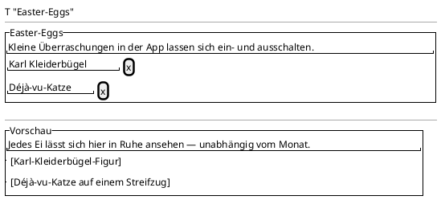

<!-- SPDX-License-Identifier: AGPL-3.0 -->
<!-- Copyright (C) 2024-2026 Breakdown RS Contributors -->
<!-- Co-authored-by: glm-5.3-flash-flex (neuralwatt) -->

# Easter-eggs — Screen Spec

## Purpose & Context
The dedicated Easter-eggs management screen (issue #708): it hosts the
complete per-egg functionality moved out of the settings screen — the
per-egg switches (issue #615; default ON, persisted on-device, globally
reactive) and the Easter-eggs gallery (issue #640). Used occasionally by
every user who wants to toggle or preview the little surprises; the
settings screen keeps only an entry tile (the counter-model of the
AI-configuration entry, issue #643).

## Navigation
Pushed from the settings screen's general section entry tile
(`settings-easter-eggs-entry`) via `Navigator.push` + `MaterialPageRoute`.
Back: the AppBar back button (`Navigator.pop`) and system back. Route
parameters: none. AUTHZ-GATE: none — the screen is post-authentication
(settings live inside the auth shell) and issues no network calls; the
per-egg preferences are on-device `shared_preferences` (deliberately NOT
the secure store — the flags are not secrets).

## Location & Context
N/A — not a planning-hierarchy surface; the screen is pushed without a
`PlanningLocation` argument, so the location strip stays hidden
(graceful-degradation rule).

## Layout

## Components & Semantics
| Element | M3 component | Semantics | Copy key |
|---|---|---|---|
| App bar title | Top app bar | Screen identity | `settings.easterEggsScreenTitle` |
| Switches group | Section header | Labels the per-egg switch list | `settings.easterEggs` |
| Switches explanatory line | Text | Explains the on/off scope | `settings.easterEggsSubtitle` |
| Karl Kleiderbügel switch | Switch list tile | Per-egg preference (default ON) | `settings.easterEggsKarlKleiderbuegel` + `settings.easterEggsKarlKleiderbuegelSubtitle` |
| Deja-vu Cat switch | Switch list tile | Per-egg preference (default ON; October-only effect on live surfaces) | `settings.easterEggsDejavuCat` + `settings.easterEggsDejavuCatSubtitle` |
| Gallery preview header | Section header | Labels the replay/preview area (issue #640) | `settings.easterEggsPreview` |
| Gallery preview line | Text | Explains the month-independent preview | `settings.easterEggsPreviewSubtitle` |
| Karl Kleiderbügel preview | Preview card | Static figure render of the egg (issue #640) | n/a (graphic, no copy) |
| Deja-vu Cat preview | Preview card | Bounded walker render of the egg — shown only while the egg switch is ON (issue #640) | n/a (graphic, no copy) |

## States
Loading: N/A — the screen reads local state synchronously (the hydrated
per-egg notifiers). Data: rows as above; each gallery preview renders
its egg's figure regardless of month, and only while that egg's switch
is ON — a switched-off egg renders no preview (the switch is the master
gate; the gallery bypasses only the October month gate, never the
preference). Error: a preference-read failure surfaces as a visible
error state on each egg row (fallback default ON); a preference-write
failure surfaces a localized snackbar (no silent discard).
Stale: N/A. Optimistic: each switch flips instantly (local preference,
no projection involved); the matching preview appears / disappears with
the same flip.

## Interactions
- Flipping a per-egg switch persists that egg's value and flips its
  global notifier immediately — the matching live consumer (Karl
  Kleiderbügel overlay / splash + empty-state cat) updates live, the
  other egg is unaffected; the egg's gallery preview follows the same
  flip.
- The gallery previews are static/bounded renders of the egg figures,
  non-interactive, honoring the system "remove animations" setting —
  they are explicit showcase surfaces, not live egg appearances (issue
  #640: makes every egg discoverable and testable regardless of month).
- The October month gate is NOT applied on this screen — bypassing it
  is the gallery's entire purpose (issue #640). The gate itself is
  untouched on the live surfaces.

## Input & Validation
N/A — no forms; the only inputs are the two preference switches.

## Accessibility & i18n
Every switch announces its state; the group headers carry visible
labels. All copy via glossary keys (`settings.easterEggs*`); German
template + English catalog. The switches are standard M3 switches —
screen-reader friendly by construction.

## Tests
- Widget: root build (app bar, one switch per egg, back affordance);
  toggling one egg flips only its notifier and persists under the flat
  per-egg key; read-failure fallback (visible error subtitle, default
  ON); write-failure localized snackbar; gallery preview per egg
  (visible when ON, absent when OFF, month-independent); remove-
  animations renders the static pose.
- Golden: `easter_eggs_{light,dark}` (issue #708).
- Unit: per-egg store Ok/Err branches, legacy migration, default-ON
  fallback (`easter_eggs_store_test.dart`).
