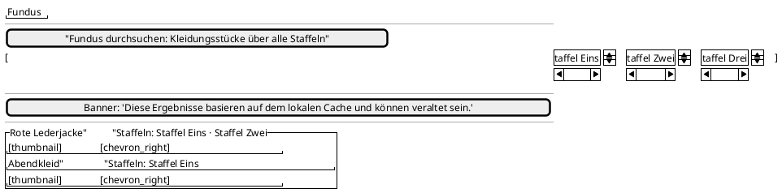

<!-- SPDX-License-Identifier: AGPL-3.0 -->
<!-- Copyright (C) 2024-2026 Breakdown RS Contributors -->
<!-- Co-authored-by: deepseek-v4.1-flash (neuralwatt) -->

# Fundus — Screen Spec

## Purpose & Context

The fundus is the **cross-season garment (piece) browse surface** for the costume department: every costume of the active project whose repertoire (the seasons it is carried into) is non-empty, across all of the project's seasons. It is used when planning a new season ("what do we already have in the wardrobe?") and when tracking a costume across productions. It is deliberately a separate surface from OmniSearch, whose four-chip, active-season-scoped contract it must not widen.

## Navigation

Reached from the **Cast** view's app bar (the `checkroom_outlined` **Fundus** action), beside the costume-category action and the search/profile actions. It is a pushed route inside the active destination's navigator; back returns to the Cast view. No route parameters — the surface reads the shell's active season for its `project_id`. AUTHZ-GATE: the surface is read-only and issues no command; it is reached only from inside the authenticated shell, and the project-scoped costume list it fetches is server-authorized. Tapping a row deep-links to the existing costume detail screen (the same screen the costume list opens), scoped to a repertoire season of the costume.

## Location & Context

The shell renders the location strip and scope chip above the content (one surface, all morphologies). The fundus is a project-level leaf: its push site passes a season-level `PlanningLocation` for the detail destination, so the strip shows Season → … when a costume's detail is opened. The fundus surface itself does not re-derive context from a second projection call — it consumes the shell's active season and the seasons projection (a read-DTO join).

## Layout

Compact layouts show the prefilter, a wrapping season-chip row and the result list. Medium and expanded layouts widen the list; the season chips stay a wrapping row. No adaptive structural difference beyond width.

## Components & Semantics

| Element | M3 component | Semantics | Copy key |
|---|---|---|---|
| Screen title | Top app bar | Fundus identity | `fundus.title` |
| Cast entry action | App-bar icon button | Opens the fundus surface | `fundus.tooltip` |
| Name prefilter | Text field | Case/diacritics-insensitive substring over notes + category | `fundus.hint` |
| Season chip | Filter chip | Toggles a season filter; all deselected = whole fundus | `fundus.seasonChip` |
| Piece row | List item | Opens the piece detail; announces designation + repertoire seasons | `fundus.row` |
| Repertoire subtitle | Text | The piece's repertoire season names | `fundus.repertoireSeasons` |
| Stale banner | Banner | Cache staleness indicator | `fundus.staleBanner` |

## States

Loading: list progress indicator. Data: prefilter + season chips + rows. Empty: no repertoire costumes in the project → `fundus.empty`; empty query before a completed fetch → `fundus.notLoaded`. Zero-match: a typed query with no hits → `fundus.zeroMatch` echoing the query. Error: a storage/read failure → `fundus.error` with a retry affordance (`Result`/`ProblemError` convention). No active season: `fundus.noSeason` empty state, no results computed. Stale: banner from the cache TTL, pull-to-refresh re-reconciles.

## Interactions

Typing filters the cached rows synchronously (no network in the query path). Tapping a season chip narrows the result set to costumes whose repertoire intersects the selected seasons; deselecting all restores the whole fundus. Tapping a row pushes the costume detail screen scoped to a repertoire season (the active season when it is in the repertoire, otherwise the first project-resident repertoire season). Pull-to-refresh and surface open run one bounded project-scoped refetch through the existing `GET /v1/costumes?project_id=` route, snapshot-replacing the project cache slice; failures degrade honestly to the cached rows (the error state is reserved for read failures).

## Input & Validation

The name prefilter accepts free text; a blank/whitespace-only query is not a query (the whole fundus is shown). Matching is dictionary folding (case-insensitive, `ä→ae` etc.), never fuzzy. No commands are dispatched from this screen.

## Accessibility & i18n

The Cast entry action and the screen carry visible labels/tooltips; season chips render their selected state through the framework's chip semantics; rows announce designation and repertoire seasons. All copy uses the German/English ARB catalogs (`fundus*` keys), never inline strings.

## Tests

Widget tests: season chips render and narrow the fundus, name prefilter matches notes, repertoire season names render, zero-match/error/no-season states. Pure matcher tests: repertoire scope, season intersection, foreign-project and non-repertoire exclusion, diacritics folding. DAO tests: project-scope isolation, repertoire round-trip, TTL staleness. Migration test: v13 → v14 creates the fundus table. Golden: `fundus_screen_light`. The cross-season deep-link contract is asserted directly on `fundusDetailSeason`/`fundusDestinationScreen`.
