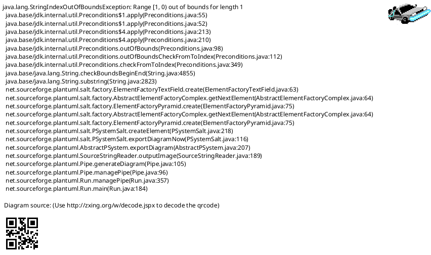
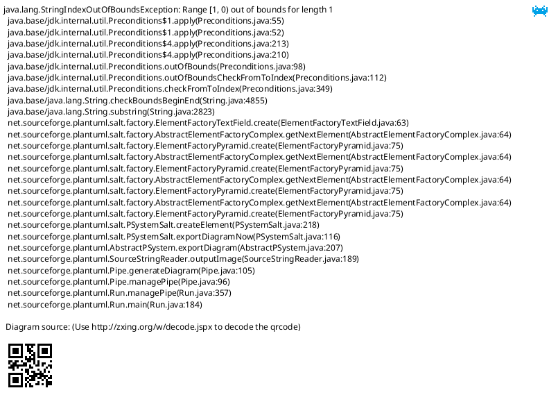
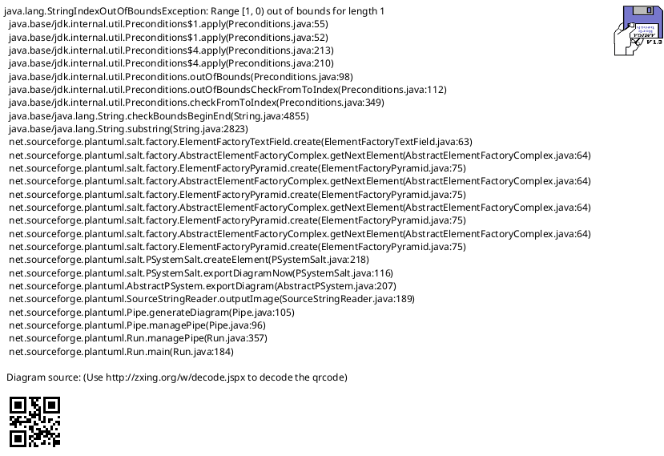

<!-- SPDX-License-Identifier: AGPL-3.0 -->
<!-- Copyright (C) 2024-2026 Breakdown RS Contributors -->
<!-- Co-authored-by: omen-alpha (opencode-go) -->
<!-- Co-authored-by: glm-5.3-flash (opencode-go) -->
<!-- Co-authored-by: space-bunny (opencode-go) -->
<!-- Co-authored-by: deepseek-v4.1-flash (neuralwatt) -->

# Navigation Shell — Screen Spec

> **Status: Soll.** Authored in the `three-view-navigation-shell` OpenSpec
> change (issue #610). Supersedes the four-destination spec of
> `redesign-app-shell-navigation` (Season | Planen | Kleidung | Mehr): the
> destinations are now three **task-oriented** views. The top bar was
> redesigned in `638-shell-top-bar-redesign` (issue #638): a status-bar-safe
> sticky bar whose first row carries the profile affordance and the scope
> pills, and whose second row carries the view title, the hierarchy
> breadcrumb and the search affordance.

## Purpose & Context
The shell is the persistent frame around all main-app content: it carries
the three top-level destinations (Cast, Script, Schedule/Dispo), the sticky
season + block + episode scope surface and each view's profile affordance,
and keeps every destination's navigation state alive across switches. It
hosts no domain content of its own — every destination root is an existing
screen. Used continuously by every user role after login.

## Navigation
Reached directly after the auth gate resolves an authenticated session;
never pushed or popped thereafter. The three destinations are destinations,
not routes on the back stack: switching is a user "jump", system back never
hops destinations (within-destination back pops that destination's own
stack first; at a destination root the back intent follows platform
app-exit semantics at the initial Cast root and is consumed elsewhere). No
route parameters; the active season is handed to the season-scoped view
roots as plain data. The former Season and Planen destinations are gone:
season management and the production spine are PUSHED from the season scope
picker's entries, and the former Mehr entries from the profile action.
AUTHZ-GATE: the shell renders only inside the auth gate; every protected
command entry it hosts keeps its own client-side membership check before
any network call.

## Location & Context
The shell owns a **two-row sticky top bar** above the view content
(issue #548 + #610 + #638):

- **Row 1 — profile and scope pills:** the profile affordance at the far
  left, followed by the three hierarchy scope pills (Season · Block ·
  Episode) in a horizontally scrollable cluster. The pills answer WHAT
  FILTERS YOUR REQUESTS and are sticky across destinations and cold starts.
- **Row 2 — view bar:** the active destination's visible title, the
  hierarchy breadcrumb (the `PlanningLocation` chain the active
  destination's topmost route was pushed with, per-route and hidden at
  destination roots) and the search affordance. The breadcrumb deepens
  through Season → Block → Episode → Scene; the scope pills are its sticky
  counterpart and keep their label-less-scope backfill and foreign-season
  narratives.

The whole top bar is inset below the system status bar in every morphology
(`SafeArea` on the view padding) — no content renders under the Android
status bar. The bar itself is never hidden: the season pill is always
present, because it is also the only affordance that can SET a season when
none is active.

## Layout

The three morphologies differ only in how the labeled destinations are
arranged around the same two-row top bar. Salt cannot express color; the
per-level pill highlight is specified in Components & Semantics.

Compact (window < 600dp) — bottom navigation bar:

Medium (600–839dp) — navigation rail beside the content:

Expanded (≥ 840dp) — permanent navigation drawer:

Static structure only: which destination is selected, the pill
selected/unselected colors, the prerequisite visibility of the block and
episode pills, and back behavior are covered in Interactions and Tests —
never in the wireframes.

## Components & Semantics
| Element | M3 component | Semantics | Copy key |
|---|---|---|---|
| Shell top bar | Sticky two-row surface | Status-bar inset in every morphology; pinned above the view content | — |
| Profile action | Icon button with tooltip + labeled sheet entries | Identity, Über die App, Einstellungen, Abmelden (never the costume categories). Left-most element of row 1 | `profileTooltip` |
| Season scope pill | Assist pill (fully rounded) | The active season; a neutral "Season wählen" pill when unset — always present, because it is the only affordance that can set a season. Selected fill: primary container | `scopeChipSeason` / `scopeChipSeasonUnset` |
| Block scope pill | Assist pill (fully rounded) | The sticky block filter; neutral "Block wählen" once a season is active but no block is set. Selected fill: secondary container. Keeps the unknown-block and foreign-season narratives | `scopeChipBlock` / `scopeChipUnknownBlock` / `scopeChipForeignSeason` / `scopeChipBlockUnset` |
| Episode scope pill | Assist pill (fully rounded) | The sticky active-episode target the quick-create entries act on; neutral "Episode wählen" once a block is scoped but no episode is set. Selected fill: tertiary container | `episodeChipTooltip` / `episodeChipUnset` |
| Pill visibility | Prerequisite rule | Season always; block once a season is active (or a block scope is set); episode once a block is scoped (or an episode scope is set). A level is never offered before its prerequisite exists | — |
| View title | Text (row 2, leading) | The active destination's visible title | `navCast` / `navScript` / `navSchedule` |
| Location strip | Row 2, beside the title | The pushed hierarchy chain, one merged semantics node; hidden at destination roots | `locationStrip` |
| Search affordance | Icon button with tooltip (row 2, trailing) | Opens the OmniSearch surface from anywhere inside the shell; never a bottom-bar destination | `omniSearchTooltip` |
| Cast view actions | Icon buttons in the Cast view's own toolbar | Costume categories (season-gated) and Fundus; they live with the Cast content, below the shell view bar — costume vocabulary never with the user settings | `castCategoriesTooltip` / `fundusTooltip` |
| Season scope picker | Screen | Season rows (pick), *Seasons verwalten*, *Produktion verwalten* | `scopeChipSeasonPickTitle` / `seasonScopeManageSeasons` / `seasonScopeManageProduction` |
| Cast destination | Navigation destination | Roster + costumes + costume categories for the active season | `navCast` |
| Script destination | Navigation destination | The season's chronological scene overview | `navScript` |
| Schedule/Dispo destination | Navigation destination | The season's shooting days in calendar order | `navSchedule` |
| Destination labels | Visible text | Mandatory on every destination in every morphology | — |
| View content | Content pane | The active destination's screen (its own app bar is gone — the shell view bar carries the title; hosted screens keep their own bars and FABs) | — |

## States
Loading: the shell renders as soon as the auth session resolves; each view
root shows its own loading state. Empty: a view with no active season shows
the shared season-selection empty state whose CTA opens the season scope
picker (never an error); Script/Schedule show their own empty narratives
once a season is set. Error: per-view Problem-Details `code` routing.
Partial: the Script and Schedule views render a partial-load notice when
their client-side fan-out failed for at least one episode. Stale/optimistic:
owned by the hosted screens.

## Interactions
Selecting a destination switches the visible content and preserves each
destination's internal position (per-destination navigators stay alive).
Tapping a scope pill opens its picker: the season picker always, the block
picker for the active season, the episode picker for the active block; a
pick sets the sticky scope and pops, so all three views rescope at once.
Tapping the profile action opens the profile sheet; tapping the search
affordance opens the OmniSearch surface inside the active destination's
navigator. System back: pops within the active destination first; at a
destination root it does not switch destinations (no multi-hop pops); at
the root of the initial (Cast) destination it requests app exit per
platform convention. Sign-out from the profile menu resets the selected
destination and drops the active season for the next session. The shell
dispatches no domain command itself.

## Input & Validation
N/A — the shell hosts no forms.

## Accessibility & i18n
Every destination renders a visible label in all three morphologies
(glossary rule — icon-only navigation is forbidden); icons reinforce only.
Each destination exposes semantics announcing label and position (e.g.
"Cast, Tab 1 von 3" — the total is a placeholder, not a baked-in literal).
The sticky top bar respects the system status-bar inset in every morphology;
its touch targets meet 48×48dp. Pill color is never the sole carrier of
meaning: the pill's visible label names the level and its state. Semantic
traversal order is row 1 (profile → season → block → episode), then row 2
(title → breadcrumb → search), then the view content. All copy via keys;
German UI copy per glossary.

## Tests
Widget tests: three morphologies via window-size overrides (360 / 700 /
1000dp), label visibility, semantics ("Cast, Tab 1 von 3"), touch-target
size; the status-bar inset (top bar never overlaps the simulated status
bar); the prerequisite visibility arms of the three scope pills and their
per-level highlight color; the title + breadcrumb + search row. Destination
state preservation and the back contract (no hop, exit at the Cast root).
Goldens: shell × {compact, medium, expanded} × {light, dark}. Gherkin: the
costume-assignment critical scenario enters through the Cast view (the
season is set from the scope picker). Integration: destination-switch smoke
on device.
