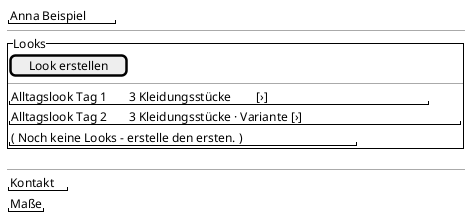
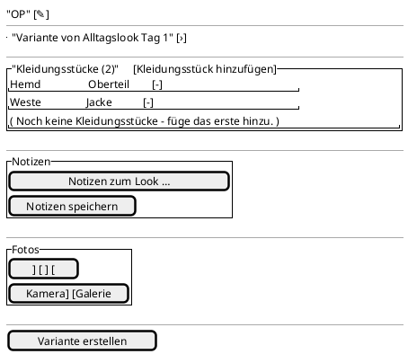

<!-- SPDX-License-Identifier: AGPL-3.0 -->
<!-- Copyright (C) 2024-2026 Breakdown RS Contributors -->
<!-- Co-authored-by: glm-5.3 (neuralwatt) -->

# Outfits (Looks) — Screen Spec

## Purpose & Context

An **outfit** is a character's composed look: the aggregation of `0..n`
garments that a scene actually casts. The look list lives on the character
detail screen (which looks does this figure have?) and the look detail manages
one look end to end — name, variant lineage, ordered garments, notes and
fitting photos. Costume design works here during preparation and on set; the
garment wardrobe (`pieces.md`) catalogues the ingredients.

## Navigation

The list is a section of the **character detail** screen
(`Cast` → character). Tapping a row pushes the look detail; the back action
returns to the character. From the look detail a garment row pushes the piece
detail of the look's season, and the variant-lineage row jumps to the source
look (replacing the current route — the lineage is a lateral move, not a drill
down). The scene detail's casting picker stays a selection-only surface: it
lists the character's looks and never edits them.

AUTHZ-GATE: every write (create, create-variant, rename, notes, add/remove
garment, photo upload/delete) awaits the season-scoped costume-department
membership before any network call. A pending fetch disables the affordance
(never denies); a resolved denial renders the localized 403 narrative and
issues no request.

## Location & Context

The character detail — and therefore the look list — is pushed with the season
location, so the shell's location strip stays visible above it. The look detail
inherits that season; it never re-derives the hierarchy from a second
projection read.

## Layout

## Components & Semantics

| Element | M3 component | Semantics | Copy key |
|---|---|---|---|
| List section title | Section heading | The character's looks | `outfitListTitle` |
| Look row | List item | Opens the look; announces name, piece count and variant marker | `outfitPieceCount` / `outfitVariantMarker` |
| List empty state | Text + CTA | No looks yet; offers creation | `outfitListEmpty` / `outfitCreateAction` |
| Create action | Text button + dialog | Creates a named look (blank name blocked); opens it | `outfitCreateTitle` / `outfitNameLabel` |
| Detail title | Top app bar | The look's own name | `outfitDetailTitle` |
| Rename action | Icon button + dialog | Renames the look | `outfitRenameTitle` |
| Variant lineage row | List item | Names the source look; jumps to it | `outfitVariantOf` / `outfitVariantMarker` |
| Pieces section | Section heading + rows | Ordered garments (`position`), layering allowed; remove per row | `outfitPiecesTitle` / `outfitRemovePieceTooltip` |
| Add-garment action | Text button + dialog | Picks from the season's garments the look does not hold yet | `outfitAddPiece` / `outfitPickPieceTitle` |
| Notes section | Text field + save | Free-text fitting notes; save disabled while unchanged | `outfitNotes` / `outfitSaveNotes` |
| Photos section | Grid + capture actions | Fitting photos with async variants | `outfitPhotos` |
| Variant action | Filled tonal button | Forks the look (copy-on-write) and opens the fork | `outfitCreateVariant` |

## States

Loading: list skeleton / detail spinner (`outfit-loading`). Data: rows above.
Empty: honest empty states for the list (`outfitListEmpty`) and the garment
list (`outfitPiecesEmpty`). Error: the list banner keyed on the problem `code`
(`outfitListFetchError`) and the command-error banner routed by command origin.
Stale: cache banner (`outfitStaleBanner`) when the character slice is older than
its TTL. Optimistic: a created/renamed/re-composed look renders immediately
with the reconciling indicator and is replaced only when the refetched
projection reaches the acknowledged version. Gone: a deleted parent shows
`outfitDetailGone` with a back action instead of an endless spinner.

## Interactions

Create: name dialog → `POST /v1/outfits` → the new look opens optimistically.
Rename/notes: field or dialog → `PATCH /v1/outfits/{id}/name|notes` with the
version echo. Add garment: picker → `POST /v1/outfits/{id}/pieces` (idempotent;
the optimistic row is not duplicated). Remove garment: confirm →
`DELETE /v1/outfits/{id}/pieces/{piece_id}` with the version echo; positions are
not renumbered locally. Create variant: `POST /v1/outfits/{id}/variants` → the
fork opens with the `variant_of` lineage; the source stays untouched. Photos:
rationale → prepare → `POST /v1/outfits/{id}/photos`, bounded variant watch
until terminal, manual refresh after the budget expires. Pull-to-refresh
re-reads the look; a failed refetch keeps the optimistic row and surfaces the
error (never a silent rollback).

## Input & Validation

The look name is required (blank is rejected client-side by the disabled save
affordance; the aggregate rejects it too). Notes accept free text. Removing a
garment confirms first (destructive rule). Problem codes drive the copy:
`outfit.forbidden` / `domain.forbidden` (role), `outfit.not-found`,
`piece.not-found` (a garment that vanished), `concurrency.version-mismatch`
(changed elsewhere — refresh), `season.archived`, `season.not-found`,
`character.not-found`, `photo.*`.

## Accessibility & i18n

Every row and action carries a visible German label from the glossary; icons
reinforce only. The variant lineage and the piece count are announced as text,
never as icon-only meaning. All copy comes from the ARB catalogs (German
template, complete English catalog), so the wardrobe speaks
"Kleidungsstück"/"Look" consistently.

## Tests

Unit: overlay merge and version fence (`shouldClearOutfitOverlay`), Err-branch
mapping per problem code, idempotent add-piece overlay. Widget: list rows
(name, piece count, variant marker), list empty state, create dialog
(blank name disabled), detail rename, ordered garment rows with add/remove,
variant fork navigation, notes save disabled while unchanged, photos grid +
capture gate, and the AUTHZ-GATE denial proof (request counter stays at zero).
Golden tests: `outfit_list_{light,dark}_{android,macos}` and
`outfit_detail_{light,dark}_{android,macos}` in the German template locale.
