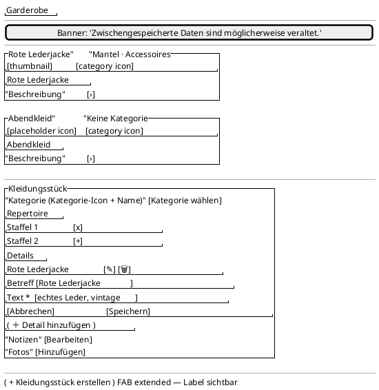

<!-- SPDX-License-Identifier: AGPL-3.0 -->
<!-- Copyright (C) 2024-2026 Breakdown RS Contributors -->
<!-- Co-authored-by: glm-5.3 (neuralwatt) -->

# Pieces (Wardrobe / Kleidungsstücke) — Screen Spec

## Purpose & Context

The wardrobe overview is the season's working contact sheet for the costume
department: one card per **piece** (a single garment in the fundus). It is used
during preparation to catalogue what exists — category, repertoire, details,
notes, photos — and to document garments with photos. A piece has **no
character binding** (that moved to the look, see `outfits.md`), so this screen
never assigns a garment to a figure.

## Navigation

Reached from the **Garderobe** destination (cast view segment / wardrobe
surface) after selecting a season and active block. A tile selection reveals
the piece editor below the grid on this screen. Back behaviour stays the
shell/tab navigation behaviour. From a piece the user can open the looks that
wear it through the character screens (piece ↔ look navigation); the piece
editor itself offers no cross-aggregate write.

AUTHZ-GATE: the editor's category, repertoire, detail, notes and photo
commands resolve the current membership before any network call; photo
capabilities are series-scoped (ADR-035 B2/S2) and the series is resolved from
the **piece** (its repertoire), never from the currently open season.

## Location & Context

The shell renders the location strip and the scope chip above the content. The
wardrobe is a season-level surface: it is pushed with the season location and
reads no deeper level. The piece detail pushed from a look carries the look's
season so the strip stays truthful when the piece belongs to a repertoire of
another season.

## Layout

Compact layouts use two columns; medium and expanded layouts use three columns.
A tile is a photo-backed card when a ready thumbnail exists and a
token-coloured placeholder card otherwise. The selected piece editor follows
the grid and contains identity editing before the secondary repertoire, notes
and photos.

## Components & Semantics

| Element | M3 component | Semantics | Copy key |
|---|---|---|---|
| Screen title | Top app bar | Wardrobe identity | `nav.wardrobe` (`navWardrobe`) |
| Piece tile | Card | Opens the inline editor; announces the piece name and category | `piece.tile` (`pieceTileLabel`) |
| Tile designation | Text overlay | The aggregate's required `name`; a legacy row falls back to first detail subject, then notes, then the generic label — never a UUID | `piece.tile.name` (`pieceTileLabelFallback`) |
| Category icon | Icon | Visual category cue; the category text stays visible | `categories.icon` |
| Placeholder | Card surface | No ready photo; announces the same designation and category | `piece.placeholder` |
| Editor heading | Section heading | Identity editing context | `pieceDetailTitle` |
| Category row | Icon + text row | The piece's single category; "Ohne Kategorie" when uncategorised | `pieceDetailCategory` |
| Category picker | Bottom sheet + rows | Season vocabulary (non-archived), one icon + visible text per option plus the clear row | `pieceDetailPickCategory` |
| Repertoire section | List + add action | The seasons the garment is listed in (m:n); adding/removing is idempotent server-side | `pieceDetailRepertoire` / `pieceDetailRepertoireAdd` |
| Detail row | Card + list item | One row per detail: `subject ?? text` as title, remainder as subtitle; trailing edit + delete | `pieceDetailDetails` |
| Inline detail editor | Embedded form + filled button | Create and edit share one editor; `text` required, `subject` optional, save disabled while `text` is empty | `pieceDetailAddDetail` / `commonSave` |
| Notes section | Secondary section | Secondary notes, never the primary identity | `pieceDetailNotes` |
| Photos section | Grid + capture actions | Piece photos (variants processed asynchronously); capture/delete behind the series-scoped gate | `pieceDetailPhotos` |
| Create action | Extended FAB | Creates a garment shell (no character, no category) and reveals its editor | `pieceAddFab` |

## States

Loading: grid progress indicator. Data: adaptive tile grid with identity
overlays. Empty: honest empty state plus the create call to action
(`piecesEmpty`). Error: Problem-Details `code` routes to localized copy with a
retry affordance (`piecesFetchError`). Stale: cache banner above the grid
(`piecesStaleBanner`). Optimistic: a shell or a saved detail renders with the
sync indicator until the version fence passes and the projection replaces it.
Photo placeholder: photo-less, pending, failed, or client-gated tiles use the
category placeholder surface.

## Interactions

Tapping a tile reveals the editor below the grid. Detail commands save subject
and text through the inline editor; delete confirms first. The category picker
dispatches the piece-level `set_category` command; a foreign-season or archived
category is rejected by the API edge with its own narrative. The repertoire
section adds/removes seasons (an archived season is rejected with its own
narrative). Notes stay in the secondary section. Photos: capture (camera or
gallery) runs the rationale → prepare → upload pipeline and watches variants
until terminal; delete confirms first. **There is no assign/reassign/unassign
affordance** — a piece has no character; casting happens on the look.

## Input & Validation

Detail editing requires non-empty text (required mark + helper, validation on
first interaction, save disabled while empty); the optional subject carries the
optional helper. The delete echoes the aggregate version. Category picking is
piece-level from the season's non-archived vocabulary. Notes accept free text.
Server Problem-Details codes — not localized backend `detail` text — drive the
error copy: `piece.validation`, `piece-detail.not-found`,
`costume-category.season-mismatch`, `costume-category.archived`,
`season.archived`, `concurrency.version-mismatch`.

## Accessibility & i18n

Every tile exposes designation and category through semantics and visible text.
Category icons reinforce the visible label and have a deterministic
unknown-category fallback. All copy comes from the German/English ARB catalogs;
the UUID is never a title. Dark/light surfaces use theme colour roles and the
grid stays two columns on compact widths.

## Tests

Widget tests: tile name/category/text, deterministic category icon, placeholder
surface, no-UUID fallback, inline editor selection, detail-save confirmation,
the inline detail editor (prefilled edit, create row, save disabled while the
required text is empty, delete confirm-first, Err branch → command-error
banner), the category section (picker options, archived rows never offered,
clear row, denial narrative with request-counter proof, season-mismatch
narrative), the repertoire section (add/remove, archived-season narrative) and
the absence of any assignment affordance. Golden tests:
`pieces_screen_{light,dark}_{android,macos}` with photo-less placeholder tiles
plus the open-editor state golden `piece_detail_editor_open`. The piece photo
flow remains part of the designated continuity Gherkin flow.
