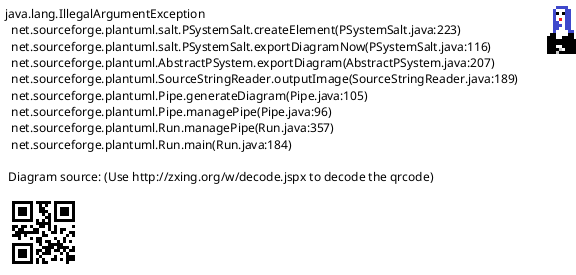

<!-- SPDX-License-Identifier: AGPL-3.0 -->
<!-- Copyright (C) 2024-2026 Breakdown RS Contributors -->
<!-- Co-authored-by: glm-5.3-flash (opencode-go) -->

# RoleExtract — Screen Spec

> **Status: degraded, landed as a route seam.** Authored in the
> `611-role-extract-view` OpenSpec change (issue #611): the Cast view's
> character row tap opens this screen. The extract rows themselves are
> gated on the backend read model (`GET /v1/characters/{id}/appearances`,
> backend issue #621) — until it ships and the Dart client is regenerated,
> the screen renders the character detail as today (list-only fallback,
> deliberately NO client-side fan-out over per-scene membership queries —
> the client never aggregates projections itself).

## Purpose & Context
The role extract is the Cast view's deep content per character: one screen
that reads like the traditional physical ring binder/Register per role —
every scene the character appears in, in script order, with that
character's costume per scene. Used by the costume department during prep
and on set as the per-role lookup surface.

## Navigation
Pushed on the Cast destination's nested navigator by tapping a character
row (the Cast entry point IS the extract — never the bare detail, issue
#611 decision). Extract rows deep-link into the existing scene detail /
costume assignment affordances. Back returns to the Cast view. The screen
receives the season scope as plain data (same seam as the roster) and the
character id as route parameter. AUTHZ-GATE: reads inherit the Cast
view's session/membership gate; this screen dispatches no command of its
own.

## Location & Context
The screen is pushed WITH the season as plain data from the Cast view
(never re-resolved). The location strip appears as soon as a hierarchy
screen (scene detail) is pushed from an extract row; the extract itself is
a season-level surface and contributes no hierarchy level of its own.

## Layout

Degraded state (landed): the character detail as today — contacts,
measurements, category row; no new wireframe (see the character detail in
the Cast view spec's roster semantics).

Soll state (pending backend #621) — static structure only:

Static structure only: extract rows carry scene number, synopsis and the
character's costume(s); the degraded detail sections stay reachable at the
bottom. Behavior lives in Interactions and States — never in Salt.

## Components & Semantics
| Element | M3 component | Semantics | Copy key |
|---|---|---|---|
| Screen title | Top app bar | Register for one character; name fallback while the row resolves | `characterDetailTitleFallback` |
| Extract row (Soll, pending #621) | List tile | The character appears in this scene, in script order; deep-links into scene detail | pending backend #621 |
| Costume chip (Soll, pending #621) | Assist chip | The character's costume for the scene; opens the costume | pending backend #621 |
| Detail sections (degraded, landed) | List sections | Contacts / measurements / category row, unchanged | unchanged detail keys |

## States
Degraded: the detail screen's loading/error/not-found states, owned by the
shared characters controller (unchanged). Soll: the per-character
appearances fetch renders as `AsyncValue` transitions; a successful
mutation elsewhere triggers the standard bounded-retry reconciliation of
the affected read; a failed refetch surfaces `AsyncError`, never swallowed; a timed-out
reconciliation retains the stale extract with a stale indicator and
pull-to-refresh as the recovery affordance.

## Interactions
Degraded: today's detail editors (full-replacement PATCH with `version`
echo from the read row). Soll: extract row tap pushes the scene detail;
costume chip opens the costume assignment affordances; pull-to-refresh
refetches the appearances read. No command is dispatched by the extract
itself.

## Input & Validation
Degraded: the detail editors' validation (unchanged). Soll extract: N/A —
read-only surface.

## Accessibility & i18n
Extract rows and chips carry semantic labels with visible text (glossary
rule); the app-bar title falls back while the character row resolves.
Copy is keyed (glossary), never inline. New extract copy keys (de/en ARB,
ICU syntax) arrive with the backend read model — CI enforces key parity.

## Tests
Widget: the Cast tap opens the role extract; degraded parity (the detail
content mounts under the extract route). On-device Gherkin:
`features-spec/role_extract.feature` ("open role extract from Cast view",
@pending until backend #621 lands).
