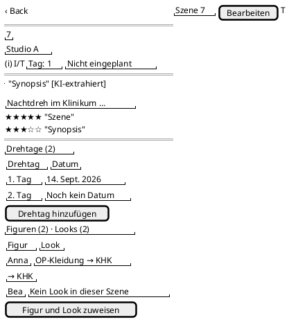

<!-- SPDX-License-Identifier: AGPL-3.0 -->
<!-- Copyright (C) 2024-2026 Breakdown RS Contributors -->
<!-- Co-authored-by: glm-5.3 (neuralwatt) -->
<!-- Co-authored-by: glm-5.3-flash-flex (neuralwatt) -->
<!-- Co-authored-by: deepseek-v4.1-flash (opencode-go) -->

# SceneDetail — Screen Spec

## Purpose & Context
The scene detail screen is the working surface for one scene's costume
preparation: its identity (number, location, mood, script day), its
synopsis, its assigned characters, the outfit each character wears IN
THIS SCENE (ordered outfit beats, issue #546), and the shooting days it
is scheduled on. Used by the costume department while prepping and on
set; short dwell time, one-handed phone use.

Issue #834 redesign: compact „Szene {n}" header, Spotify-informed
sections (cards + whitespace, NO divider lines), sections the reader does
not need permanently collapsed by default, a dedicated synopsis area with
AI provenance + Decision-Model ratings, and one edit sheet for all scene
fields. Issue #902 makes the CAST an always-visible table with a row-level
context menu, and issue #903 gives the SHOOTING DAYS the same treatment (see
*Table chrome* below).

## Navigation
Reached from the Planen tab → Block → Episode → scene list (drill-down
push). Back returns to the episode's scene list. Route parameters:
`seasonId`, `episodeId`, `sceneId` — all read-DTO ids the user acted on
(never a second projection lookup to fill in command context — CQRS
boundary). AUTHZ-GATE: outfit-beat commands (`POST/PATCH/DELETE
/v1/scenes/{id}/outfits…`) and the details update
(`PATCH /v1/scenes/{id}`) run the client-side session check BEFORE any
network call (denial shows the localized 403 narrative and never issues
the request); the beat commands additionally run the `assign_costumes`
capability check.

## Location & Context
The screen is pushed with a typed `SceneLocation` argument (issue #548):
the shell's location strip renders Season → Block → Episode → Scene
from the pushed chain. The scope chip (sticky active-block filter) is
shell-owned; this screen does not duplicate it. Direct-pumped
tests/goldens push without the argument — the strip stays hidden.

## Layout

Static structure only (rule box): the app bar carries the scene NUMBER
(„Szene {n}") and the edit affordance; the identity block (numeral +
location + metadata chips) reads as page identity — no card border, no
`SliverAppBar`. The synopsis renders as an always-visible card. Ratings render
only when a score exists (honest absence).

**No scene-detail section collapses (issues #902 and #903).** A cast list
(„who is in this scene, in which look") and the days a scene is planned on are
page *content*, not secondary details: both render a plain section header
(counts kept: „Figuren 2 · Looks 3", „Drehtage 2") followed by their table, on
a cold open, with no expand step. `SectionCard` stays the component for
sections that legitimately collapse; this screen uses none.

**Table chrome vs. section chrome (issues #902 and #903, narrowing the #834
rule).** #834 rejected the `ExpansionTile`'s own top/bottom *section* chrome;
that rule still holds — no card outline, no `Divider`, no `ExpansionTile`
borders. Each table has its own *table* chrome, drawn only from `ColorScheme`
roles, and both tables use the SAME ones:

- a label band on `surfaceContainerHighest` with `onSurfaceVariant` text
  (contrast is a scheme property, not a drawn stroke — the reported dark-mode
  defect was that nothing separated the rows there);
- zebra rows alternating `surface` / `surfaceContainerLow`, plus a
  `DecoratedBox` hairline in `outlineVariant` as reinforcement — a **border**,
  never a `Divider` widget, so the #834 assertion stays honest;
- one shared column flex per table (cast 4/6, days 4/3) and one shared inset
  for body and label band, so each column starts at the same x as its label at
  every width, plus a fixed trailing chevron column;
- long labels wrap to a second line instead of ellipsizing.

**Order (issue #834 follow-up):** the shooting days come FIRST — a scene is
planned before it is cast, and the dispo is built from the days, not from the
looks. Figuren and Looks share ONE table: separate lists made the reader join
them by hand, and a figure without a look was a dead end one section away from
the affordance that fixes it. Every row is one (figure, look) pair, the header
carries both counts, and a figure with several looks renders one row per look
(`→` = change step) so each look stays removable on its own.

## Components & Semantics
| Element | M3 component | Semantics | Copy key |
|---|---|---|---|
| App-bar title | AppBar title | `Szene {number}` — the summary is page content | `sceneDetailTitle` |
| Edit affordance | AppBar IconButton | Opens the one edit sheet (all fields) | `sceneDetailEditTooltip` |
| Identity block | Column (numeral, title, chip row) | Page identity: number, location, mood (#721 icons — one per named location, so the MIXED `A/I/T` renders too), script day (+ its day-binding icon), geplant/ungeplant | `sceneDetailTitle`, `sceneLoc`, `sceneMood`, `sceneDay`, `sceneScheduled` |
| Provenance badge | `AiProvenanceBadge` | `SceneView.source = AiExtracted` → „KI-extrahiert"; Manual/absent → nothing | `aiProvenanceBadge` |
| Synopsis card | Card + title row | Full `summary`; empty state „Keine Synopsis" (never a fabricated line) | `sceneDetailSynopsisTitle`, `sceneDetailNoSynopsis` |
| Rating rows | `AiScoreStars` | `synopsisScore` / `sceneScore` as stars; `null` renders nothing | `sceneDetailRatingSynopsis`, `sceneDetailRatingScene`, `aiScoreStarsLabel` |
| Section headers | Plain section header | NEITHER table collapses (issues #902, #903): both are plain headers over their table. Counts stay visible („Figuren 2 · Looks 3", „Drehtage 2") | `sceneDetailCastTitle`, `sceneDetailShootingDaysTitle` |
| Cast table label band | Container row of `labelSmall` cells | Band on `surfaceContainerHighest` naming the two cells („Figur" / „Look"), same column flex as the rows so the labels sit over their columns | `sceneDetailCastColumnCharacter`, `sceneDetailCastColumnLook` |
| Cast row | `InkWell` row (2 cells + chevron) | One (figure, look) pair, banded (`surface`/`surfaceContainerLow`) with an `outlineVariant` hairline: the figure, its look (category icon + wardrobe cue), the change arrow for further looks. The row is ONE tap target (≥ 48 dp) that opens the row menu; the trailing `chevron_right` is the affordance cue | `sceneDetailCastMenuHint` (Semantics) |
| Cast row menu | `showModalBottomSheet` + `ListTile`s | THE four actions, as labelled items (tap or long-press on the row): Bearbeiten (→ Cast screen, DISABLED — never absent — when no `SeasonView` resolves), Look zuweisen / + Lookwechsel, Look entfernen (only on a row that carries a beat), Figur entfernen (only on the figure's first row) | `sceneDetailCastMenuTitle`, `sceneDetailEditCharacterTooltip`, `sceneDetailAssignOutfit`, `sceneDetailAddChange`, `sceneDetailRemoveOutfitTooltip`, `sceneDetailRemoveCharacterTooltip` |
| Assign figure + look | `FilledButton.tonalIcon` | The section's one assign flow: pick an unassigned figure, then its look (a cancelled look picker leaves the figure cast — a role without a costume is a real state) | `sceneDetailAssignCharacterAndLook` |
| Script-day chip | `_HeaderChip` + IconButton | Binds the day the SCRIPT states („Tag 1") to a real shooting day of the episode; disabled when no candidate exists | `sceneDay`, `sceneDetailAssignScriptDayTooltip` |
| Days table label band | Container row of `labelSmall` cells | Band on `surfaceContainerHighest` naming the two cells („Drehtag" / „Datum"), same column flex (4/3) + chevron spacer as the rows | `sceneDetailShootingDayColumnDay`, `sceneDetailShootingDayColumnDate` |
| Day row | `InkWell` row (2 cells + chevron) | One scheduled day, banded (`surface`/`surfaceContainerLow`) with an `outlineVariant` hairline. ONE tap target (≥ 48 dp) opening the day menu; the trailing `chevron_right` is the cue | `sceneDetailRowActions` (Semantics) |
| Day date cell | Text / icon + text | The day's date in the ACTIVE LOCALE (`formatMediumDate`, never the ISO string). No date → „Noch kein Datum" in `onSurfaceVariant` with an `event_busy` glyph (the row states what is missing; the menu item next to it is the fix). A day the projection did not resolve renders the fallback label and NO date cell | `shootingDayDate`, `shootingDayNoDate`, `sceneShootDayFallback` |
| Day row menu | `showModalBottomSheet` + `ListTile`s | THE four day actions, as labelled items (tap or long-press on the row), titled with the row's own day label: **Day-Board öffnen**, **Datum festlegen / Datum ändern**, **Auf anderen Drehtag umhängen**, **Termin entfernen**. Board and date are DISABLED (never absent) without a resolved day; the move item is disabled when no candidate exists | `sceneDetailOpenDayBoard`, `sceneDetailSetDayDate`, `sceneDetailChangeDayDate`, `sceneDetailMoveToOtherDay`, `shootingDayUnscheduleButton` |
| Schedule button | `FilledButton.tonalIcon` | Appends the scene to the picked day — the label says so („Drehtag hinzufügen"), and „Drehtag anlegen" stays the day-aggregate create next to it | `sceneDetailAddShootingDay`, `sceneDetailCreateFirstDay` |
| Day picker sheet | `showModalBottomSheet` + `ListTile`s | The candidate days; its title is NEUTRAL over its three entry points (section button, row move item, script-day chip) | `sceneDetailPickShootingDay` |
| Change arrow | `→` prefix text | Change from the previous beat of the character | — (punctuation, not copy) |
| Remove beat / unassign / remove from day | Menu item + (for scene data) confirm dialog | Removes a RELATION from the scene: the beat removal and the figure removal live in the cast row menu behind their confirm dialogs, the day removal is the day menu's labelled item (reversible by re-scheduling, so no confirm) | `sceneDetailRemoveOutfitTooltip`, `sceneDetailRemoveCharacterTooltip`, `shootingDayUnscheduleButton` |
| Empty states | ListTile + button | Honest empty copy per section | `sceneDetailNoCharacters`, `sceneDetailNoOutfitInScene`, `sceneDetailNoShootingDays` |
| Edit sheet | Bottom sheet | Number, location, mood (canonical chips + free-text fallback), script day, synopsis | `sceneDetailEdit*` keys |
| Command error | SnackBar | Localized per problem `code` | `sceneBeatError*`, `sceneUpdateError*` keys |

## States
Loading: first snapshot in flight → centered spinner. Data: layout
above. Empty: scene without characters renders the section's explicit
empty line. Stale: retained rows with the cache-freshness flag.
Optimistic: after a 2xx ack (beat command or details update) the screen
renders the optimistic state immediately (version-fenced overlay);
while reconciling a spinner row shows, on bounded-retry exhaustion a
cloud-off row with warning copy — never a silent discard. Error: read
errors per `code` (`sceneDetailFetchError`); command errors per `code`
(`sceneBeatErrorNotInScene`, `sceneBeatErrorNotFound`,
`sceneBeatErrorValidation`, `sceneUpdateErrorValidation`,
`concurrency.version-mismatch` → `sceneUpdateErrorConflict` retry
narrative, sign-in/network/generic fallbacks).

## Interactions
* Edit scene (app bar): opens `SceneEditSheet` → save dispatches
  `PATCH /v1/scenes/{id}` with the `version` ECHOED from the acted-on
  `SceneView` (optimistic locking, #473). 2xx → optimistic overlay +
  bounded-retry refetch; `409 concurrency.version-mismatch` → localized
  retry narrative + projection refresh, never an automatic re-dispatch.
  Mood: canonical chips (`I/T` … `I/A/AB` and the `A/I/*` mixed forms) plus a
  free-text fallback; a stored value outside the canonical set renders as its
  own selected chip and is echoed verbatim unless replaced — never destroyed. Number
  editing warns (hint line) but invents no uniqueness rule (no backend
  invariant exists; a separate issue owns the cross-aggregate
  doctrine).
* Pick outfit (row menu item, or the section's assign flow): opens the picker sheet
  → `POST /v1/scenes/{id}/outfits` with the acted-on scene's version
  echo (version fence: freshest known version wins). 2xx → optimistic
  beat append + bounded-retry reconciliation.
* Row actions (issue #902): tapping (or long-pressing) a cast row opens ONE
  labelled menu — a context menu without a cue is a hidden affordance, so the
  row carries a trailing chevron and a `Semantics(button: true, hint: …)` node.
  The item set is per row: Bearbeiten and Figur entfernen on the figure's first
  row only, Look entfernen on any row that carries a beat (that row's OWN
  beat), the add-look item on every row of the figure (the command appends).
  Choosing an item closes the sheet BEFORE its dialog/picker opens.
* Remove beat: confirm-first dialog → single remaining beat dispatches
  the clear-all, otherwise the per-order removal.
* Assign/unassign character, schedule/unschedule day: picker + version
  echo, optimistic-after-2xx (see the characters/shooting-days change
  specs). „Figur und Look zuweisen" chains two commands (assign, then the
  look picker) because that is the aggregate order; a look removal on a
  two-look figure removes one beat, the LAST one clears all.
* Row actions (issue #903): tapping (or long-pressing) a DAY row opens its
  labelled menu — the day board, the day's DATE, "move to another day" and
  "remove from this day". The date item opens the same Material chooser the
  shooting-days screen uses (seeded with the day's date, else today; bounds
  2000–2100) and dispatches the existing `reschedule` with the day's own
  `version` — no new endpoint, provider or controller method. One date format on
  both screens; a failure shows the localized `shootingDayErrorCopy`.
* Move to another day: `scheduleScene` first, then `unscheduleScene` with
  the ACK version — a refused schedule leaves the scene on the day it had,
  and a refused release leaves it on both (two visible, removable rows)
  instead of on none.
* Edit a cast figure: the row menu's **Figur bearbeiten (Cast)** item pushes
  the Cast screen (character detail) with the
  season row from the route's `SceneLocation` (the DTO the user navigated
  from), falling back to the fenced `seasonsView` projection — never a
  second projection lookup. When no row resolves, the item renders
  disabled instead of disappearing. Returning refreshes the scene so a
  renamed/removed look does not keep its old label.
* Pull-to-refresh: reconciliation pass (single-flight, bounded retries).

## Input & Validation
Edit sheet: number parses as an integer (empty → `null`); location,
script day and synopsis are free text, trimmed, empty → `null` on the
wire. Mood: canonical chip OR free text — the field and the chips stay
in sync (picking a chip fills the field; editing the field drops the
chip). No fabricated validation: duplicate scene numbers are possible
by design until a backend invariant lands. Problem-code → copy mapping:
`scene.validation` → `sceneUpdateErrorValidation`,
`concurrency.version-mismatch` → `sceneUpdateErrorConflict`,
`scene.character-not-in-scene` → `sceneBeatErrorNotInScene`,
`scene.beat-not-found` → `sceneBeatErrorNotFound`, auth/membership
denials → sign-in copy, `transport.*` → network copy, else generic with
the code.

## Accessibility & i18n
All section headers, buttons, and remove affordances carry visible
labels (glossary rule); icons reinforce only. Each table row — cast AND day —
is ONE accessible tap target (`Semantics(button: true, hint: …)`, ≥ 48 dp)
whose actions are labelled menu items; nothing in either table is icon-only
(issues #902, #903). Rating rows announce the bucket label via the
`AiScoreStars` semantics node; the change arrow and the row chevrons are
decorative. All copy via ARB keys (de template + en parity gate); backend
`detail` text is never rendered.

## Tests
Widget tests (Tier 2): app bar reads „Szene {n}" (never the summary);
NEITHER table collapses (issues #902, #903); NO `Divider` in either table,
while both tables' label band/zebra/hairline chrome comes from `ColorScheme`
roles in BOTH brightnesses; each row is one ≥ 48 dp tap target with a chevron
and a semantics hint; tap and long-press open the same labelled menu; per-row
item availability (no look → no Look entfernen, change step → no Figur
entfernen, unresolved day → board/date disabled, no candidate → move disabled);
Bearbeiten disabled (never absent) when no season row resolves; the day date
cell renders the LOCALIZED date, says „Noch kein Datum" without one, and
renders no cell for an unresolved day; the date chooser dispatches exactly one
`reschedule` with the day's version; the reconciling and the stale/cloud-off
status rows render BELOW the cast table; synopsis in full + empty state;
provenance badge only for `AiExtracted`; stars only for present scores;
edit-sheet version echo; non-canonical mood survives; canonical chip replaces;
conflict narrative; beat flows (unchanged coverage from
#546/#550/#669/#549).
Golden (Tier 2): re-baselined with the #902 cast table and the #903 days table
(German template locale) in LIGHT and DARK — the dark-mode picture is the
reported defect.
Gherkin (Tier 3): `features-spec/outfit_casting.feature` casts through the row
menu; `I open the day board for shooting day …` opens the day row's menu first
(the retired inline icon). No new `.feature` file.
