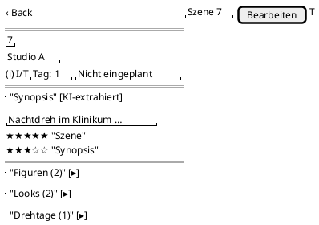

<!-- SPDX-License-Identifier: AGPL-3.0 -->
<!-- Copyright (C) 2024-2026 Breakdown RS Contributors -->
<!-- Co-authored-by: glm-5.3 (neuralwatt) -->
<!-- Co-authored-by: glm-5.3-flash-flex (neuralwatt) -->

# SceneDetail — Screen Spec

## Purpose & Context
The scene detail screen is the working surface for one scene's costume
preparation: its identity (number, location, mood, script day), its
synopsis, its assigned characters, the outfit each character wears IN
THIS SCENE (ordered outfit beats, issue #546), and the shooting days it
is scheduled on. Used by the costume department while prepping and on
set; short dwell time, one-handed phone use.

Issue #834 redesign: compact „Szene {n}" header, Spotify-informed
sections (cards + whitespace, NO divider lines), every section collapsed
by default, a dedicated synopsis area with AI provenance + Decision-
Model ratings, and one edit sheet for all scene fields.

## Navigation
Reached from the Planen tab → Block → Episode → scene list (drill-down
push). Back returns to the episode's scene list. Route parameters:
`seasonId`, `episodeId`, `sceneId` — all read-DTO ids the user acted on
(never a second projection lookup to fill in command context — CQRS
boundary). AUTHZ-GATE: outfit-beat commands (`POST/PATCH/DELETE
/v1/scenes/{id}/outfits…`) and the details update
(`PATCH /v1/scenes/{id}`) run the client-side session check BEFORE any
network call (denial shows the localized 403 narrative and never issues
the request); the beat commands additionally run the `assign_costumes`
capability check.

## Location & Context
The screen is pushed with a typed `SceneLocation` argument (issue #548):
the shell's location strip renders Season → Block → Episode → Scene
from the pushed chain. The scope chip (sticky active-block filter) is
shell-owned; this screen does not duplicate it. Direct-pumped
tests/goldens push without the argument — the strip stays hidden.

## Layout

Static structure only (rule box): the app bar carries the scene NUMBER
(„Szene {n}") and the edit affordance; the identity block (numeral +
location + metadata chips) reads as page identity — no card border, no
`SliverAppBar`. The synopsis renders as an always-visible card; the
three list sections are `SectionCard`s (card surface, no divider
chrome) COLLAPSED by default, counts in the header. Ratings render only
when a score exists (honest absence).

## Components & Semantics
| Element | M3 component | Semantics | Copy key |
|---|---|---|---|
| App-bar title | AppBar title | `Szene {number}` — the summary is page content | `sceneDetailTitle` |
| Edit affordance | AppBar IconButton | Opens the one edit sheet (all fields) | `sceneDetailEditTooltip` |
| Identity block | Column (numeral, title, chip row) | Page identity: number, location, mood (#721 icons), script day, geplant/ungeplant | `sceneDetailTitle`, `sceneLoc`, `sceneMood`, `sceneDay`, `sceneScheduled` |
| Provenance badge | `AiProvenanceBadge` | `SceneView.source = AiExtracted` → „KI-extrahiert"; Manual/absent → nothing | `aiProvenanceBadge` |
| Synopsis card | Card + title row | Full `summary`; empty state „Keine Synopsis" (never a fabricated line) | `sceneDetailSynopsisTitle`, `sceneDetailNoSynopsis` |
| Rating rows | `AiScoreStars` | `synopsisScore` / `sceneScore` as stars; `null` renders nothing | `sceneDetailRatingSynopsis`, `sceneDetailRatingScene`, `aiScoreStarsLabel` |
| Section headers | `SectionCard` title | Collapsed-by-default sections; count stays visible | `sceneDetailCharactersTitle`, `sceneDetailOutfitsTitle`, `sceneDetailShootingDaysTitle` |
| Beat row | ListTile | One (character, beat): outfit identity + wardrobe cue | `pieceTileLabelFallback` fallback |
| Change arrow | `→` prefix text | Change from the previous beat of the character | — (punctuation, not copy) |
| Remove beat / unassign / unschedule | IconButton (confirm-first) | Removes the relation from the scene | `sceneDetailRemoveOutfitTooltip`, `sceneDetailRemoveCharacterTooltip`, `shootingDayUnscheduleButton` |
| Empty states | ListTile + button | Honest empty copy per section | `sceneDetailNoCharacters`, `sceneDetailNoOutfitInScene`, `sceneDetailNoShootingDays` |
| Edit sheet | Bottom sheet | Number, location, mood (canonical chips + free-text fallback), script day, synopsis | `sceneDetailEdit*` keys |
| Command error | SnackBar | Localized per problem `code` | `sceneBeatError*`, `sceneUpdateError*` keys |

## States
Loading: first snapshot in flight → centered spinner. Data: layout
above. Empty: scene without characters renders the section's explicit
empty line. Stale: retained rows with the cache-freshness flag.
Optimistic: after a 2xx ack (beat command or details update) the screen
renders the optimistic state immediately (version-fenced overlay);
while reconciling a spinner row shows, on bounded-retry exhaustion a
cloud-off row with warning copy — never a silent discard. Error: read
errors per `code` (`sceneDetailFetchError`); command errors per `code`
(`sceneBeatErrorNotInScene`, `sceneBeatErrorNotFound`,
`sceneBeatErrorValidation`, `sceneUpdateErrorValidation`,
`concurrency.version-mismatch` → `sceneUpdateErrorConflict` retry
narrative, sign-in/network/generic fallbacks).

## Interactions
* Edit scene (app bar): opens `SceneEditSheet` → save dispatches
  `PATCH /v1/scenes/{id}` with the `version` ECHOED from the acted-on
  `SceneView` (optimistic locking, #473). 2xx → optimistic overlay +
  bounded-retry refetch; `409 concurrency.version-mismatch` → localized
  retry narrative + projection refresh, never an automatic re-dispatch.
  Mood: canonical chips (`I/T` … `I/A/AB`) plus a free-text fallback; a
  stored value outside the canonical set renders as its own selected
  chip and is echoed verbatim unless replaced — never destroyed. Number
  editing warns (hint line) but invents no uniqueness rule (no backend
  invariant exists; a separate issue owns the cross-aggregate
  doctrine).
* Pick outfit (empty state or `+ Lookwechsel`): opens the picker sheet
  → `POST /v1/scenes/{id}/outfits` with the acted-on scene's version
  echo (version fence: freshest known version wins). 2xx → optimistic
  beat append + bounded-retry reconciliation.
* Remove beat: confirm-first dialog → single remaining beat dispatches
  the clear-all, otherwise the per-order removal.
* Assign/unassign character, schedule/unschedule day: picker + version
  echo, optimistic-after-2xx (see the characters/shooting-days change
  specs).
* Pull-to-refresh: reconciliation pass (single-flight, bounded retries).

## Input & Validation
Edit sheet: number parses as an integer (empty → `null`); location,
script day and synopsis are free text, trimmed, empty → `null` on the
wire. Mood: canonical chip OR free text — the field and the chips stay
in sync (picking a chip fills the field; editing the field drops the
chip). No fabricated validation: duplicate scene numbers are possible
by design until a backend invariant lands. Problem-code → copy mapping:
`scene.validation` → `sceneUpdateErrorValidation`,
`concurrency.version-mismatch` → `sceneUpdateErrorConflict`,
`scene.character-not-in-scene` → `sceneBeatErrorNotInScene`,
`scene.beat-not-found` → `sceneBeatErrorNotFound`, auth/membership
denials → sign-in copy, `transport.*` → network copy, else generic with
the code.

## Accessibility & i18n
All section headers, buttons, and remove affordances carry visible
labels (glossary rule); icons reinforce only. Rating rows announce the
bucket label via the `AiScoreStars` semantics node; the change arrow is
decorative. All copy via ARB keys (de template + en parity gate);
backend `detail` text is never rendered.

## Tests
Widget tests (Tier 2): app bar reads „Szene {n}" (never the summary);
sections collapsed by default with counts visible; NO `Divider` in any
expansion state; synopsis in full + empty state; provenance badge only
for `AiExtracted`; stars only for present scores; edit-sheet version
echo; non-canonical mood survives; canonical chip replaces; conflict
narrative; beat flows (unchanged coverage from #546/#550/#669/#549).
Golden (Tier 2): re-baselined with the #834 layout (German template
locale). No Gherkin: the scene-costume flow is not one of the three
designated critical scopes.
