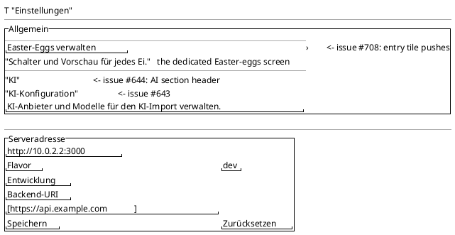

<!-- SPDX-License-Identifier: AGPL-3.0 -->
<!-- Copyright (C) 2024-2026 Breakdown RS Contributors -->
<!-- Co-authored-by: deepseek-v4.1-flash (neuralwatt) -->
<!-- Co-authored-by: glm-5.3-flash (opencode-go) -->
<!-- Co-authored-by: glm-5.3-flash-flex (neuralwatt) -->

# Settings — Screen Spec

## Purpose & Context
The app's dedicated full-screen settings: general app settings (every
flavor) — including the Easter-eggs entry tile (issue #708, pushing the
dedicated [Easter-eggs screen](easter-eggs.md)) and the central
AI-configuration entry (issue #643) grouped in an "AI" section — and,
dev-flavor-only, the development backend switch. It replaces the former
`SettingsDialog` (issue #516). Used occasionally by every user
(Easter-eggs preference, AI-import review) and regularly by developers
(backend override).

## Navigation
Pushed from the Mehr tab's labeled tile „Einstellungen" (`mehr-settings`)
via `Navigator.push` + `MaterialPageRoute`. Back: the AppBar back
button (`Navigator.pop`) and system back — the screen never pops the
session. Route parameters: none. AUTHZ-GATE: the screen itself is
post-authentication (Mehr tab lives inside the auth shell); the save /
reset actions issue requests against the configured backend through the
existing `SessionReset` coordinator, which owns the auth fence — no
additional client-side membership gate applies (server-ownership rule).
The AI-section entries are the general-section elements with entry-specific
gates — see Interactions.

## Location & Context
N/A — settings are not a planning-hierarchy surface; the screen is
pushed without a `PlanningLocation` argument, so the location strip
stays hidden (graceful-degradation rule).

## Layout

In the `prod` flavor the „Entwicklung" section is absent; the read-only
rows Serveradresse + Flavor remain, followed by the explanatory prod
note (store compliance). The Easter-eggs per-egg switches and gallery
live on the dedicated [Easter-eggs screen](easter-eggs.md) since issue
#708; the general section keeps only the entry tile.

## Components & Semantics
| Element | M3 component | Semantics | Copy key |
|---|---|---|---|
| App bar title | Top app bar | Screen identity | `settings.title` |
| General section | Section header | Groups always-available settings | `settings.general` |
| Easter-eggs entry tile | List item (push, chevron) | Central entry to the dedicated Easter-eggs screen (issue #708 — the per-egg switches and gallery live there; counter-model of the AI-configuration entry); no membership gate — the preferences are local-only | `settings.easterEggsEntryTitle` + `settings.easterEggsEntrySubtitle` |
| AI section | Section header | Groups the AI-configuration entry (issue #644) | `settings.ai` |
| AI-configuration entry | List item (push, chevron) | Central entry to `AiConfigScreen` (issue #643); visible only while the season-scoped membership resolves to an active costume-dept role — see Interactions | `settings.aiConfig` + `settings.aiConfigSubtitle` |
| Development section | Section header | Labels the dev-only area | `settings.dev` |
| Server address row | List item (read-only) | Active effective API base | `settings.serverAddress` |
| Flavor row | List item (read-only) | Active build flavor | `settings.flavor` |
| Backend-URI field | Text field | dev-only editable override with inline validation | `settings.backendUri` |
| Save button | Filled button | Persist → Dio rebuild → invalidate | `settings.save` |
| Reset button | Text button | Remove override, back to default | `settings.reset` |
| Prod note | Text | Explains the absent editor in prod | `settings.prodNote` |

## States
Loading: N/A — the screen reads local state synchronously (the effective
base), except the AI-configuration entry's membership gate: while that
membership fetch is in flight the entry renders nothing (a pending fetch
hides, never denies — D3), converging to visible/hidden once resolved.
Data: rows as above. The AI-configuration entry renders only while the
season-scoped membership resolves with an active costume-dept role
(issue #643 — see Interactions). Easter-eggs state lives entirely on the
dedicated screen (issue #708). Error: backend-URI save errors render
inline keyed on `code` via the validation copy; a failed membership
fetch renders no AI-configuration entry (hidden, with the retry
affordance living on the gated surface, not the settings list).
Stale: N/A. Optimistic: N/A (no command dispatches from this screen; the
developer backend switch is a synchronous local-override flow).

## Interactions
- Easter-eggs entry tile (issue #708): pushes the dedicated
  [Easter-eggs screen](easter-eggs.md) (`MaterialPageRoute`,
  fire-and-forget, same as the AI-config entry). No membership gate —
  the tile dispatches no command and reads no network resource; the
  per-egg preferences are on-device `shared_preferences`. The touch
  target is a standard `ListTile` (≥ 48×48 dp).
- AI-configuration entry (issue #643): `// AUTHZ-GATE:` — the tile is
  offered only while the client-side membership gate resolves via the
  sticky active-block scope (`activeBlockProvider` →
  `currentMembershipProvider(scope.seasonId)` →
  `hasActiveCostumeRoleInSeason`): no scope, a pending/erroring fetch,
  or a resolved denial render no tile (D3 — hide, never deny). The
  server stays authoritative: the AI-config handlers are
  handler-internally gated by `has_active_credential_role`
  (`costume_designer`/`costume_assistant`, any active membership — not
  on the wire, no new API surface). The season predicate the client
  reads is deliberately wider (adds `wardrobe_supervisor`), so a
  supervisor-only member may open the screen and receive the existing
  localized 403 narrative (`AiConfigScreen`'s documented D4 exception)
  — honest degradation, never a bypass. Tap pushes `AiConfigScreen`
  (`MaterialPageRoute`, fire-and-forget, same as the wizard and
  import-submit entries). The touch target is a standard `ListTile`
  (≥ 48×48 dp).
- ~~AI-imports entry (issue #644)~~ — removed from Settings by issue
  #672: the jobs list is the operational surface users check repeatedly,
  not a setting; the entry moved to the account drawer
  (`profile-ai-imports`, same route name kept for the apply-outcome
  `popUntil` contract).
- Save (dev): validates inline (`validateApiBase`); on success runs the
  `SessionReset.switchBackend` flow with a linear progress indicator,
  then re-reads the effective base.
- Reset (dev): `SessionReset.resetBackendToDefault`, restores the field
  to the effective base.
- Dismissing the save/reset while a progress run is active: buttons are
  disabled (previous dialog behavior carried over).

## Input & Validation
Backend-URI (dev only): absolute `http`/`https` URI; cleartext `http`
accepted only for emulator/loopback hosts (CWE-319 rule). Validation
errors and save errors surface via the existing `apiBaseValidationCopy`
mapping keyed on `code` — never on `detail` prose.

## Accessibility & i18n
Every destination/action carries a visible label; the entry tiles are
single merged, enabled, tappable semantics nodes whose labels carry the
visible titles. All copy via glossary keys (`settings.*`); German
template + English catalog.

## Tests
- Widget: tile pushes the screen (no dialog); back navigation;
  general section in both flavors; Easter-eggs entry tile present and
  pushes the dedicated screen, inline per-egg sections absent (issue
  #708); dev section dev-only; save/reset/progress flows;
  AI-configuration entry visible on an active costume-dept membership,
  hidden without an active-block scope / while pending / on a resolved
  denial, tap pushes `AiConfigScreen` (issue #643); the AI-imports
  Settings tile is gone (issue #672, moved to the account drawer).
- Golden: `settings_dev_{light,dark}` + `settings_prod_{light,dark}`
  (replacing the former dialog goldens) + visible AI-configuration
  entry `{light,dark}` (issue #643); regenerated with the #708
  entry-tile layout.
- Unit: backend-URI validation copy mapping (the per-egg store
  Ok/Err branches live with the Easter-eggs screen, issue #708).
