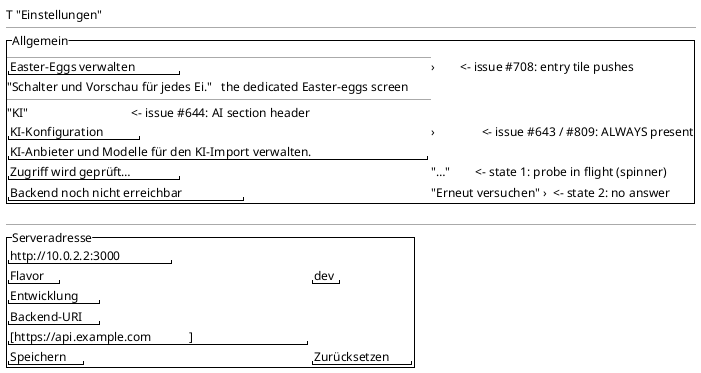

<!-- SPDX-License-Identifier: AGPL-3.0 -->
<!-- Copyright (C) 2024-2026 Breakdown RS Contributors -->
<!-- Co-authored-by: deepseek-v4.1-flash (neuralwatt) -->
<!-- Co-authored-by: glm-5.3-flash (opencode-go) -->
<!-- Co-authored-by: glm-5.3-flash-flex (neuralwatt) -->
<!-- Co-authored-by: deepseek-v4.1-flash (opencode-go) -->

# Settings — Screen Spec

## Purpose & Context
The app's dedicated full-screen settings: general app settings (every
flavor) — including the Easter-eggs entry tile (issue #708, pushing the
dedicated [Easter-eggs screen](easter-eggs.md)) and the central
AI-configuration entry (issue #643) grouped in an "AI" section — and,
dev-flavor-only, the development backend switch. It replaces the former
`SettingsDialog` (issue #516). Used occasionally by every user
(Easter-eggs preference, AI-import review) and regularly by developers
(backend override).

## Navigation
Pushed from the Mehr tab's labeled tile „Einstellungen" (`mehr-settings`)
via `Navigator.push` + `MaterialPageRoute`. Back: the AppBar back
button (`Navigator.pop`) and system back — the screen never pops the
session. Route parameters: none. AUTHZ-GATE: the screen itself is
post-authentication (Mehr tab lives inside the auth shell); the save /
reset actions issue requests against the configured backend through the
existing `SessionReset` coordinator, which owns the auth fence — no
additional client-side membership gate applies (server-ownership rule).
The AI-section entries follow the same server-ownership rule: a
configuration entry point is never hidden by an unresolved scope — it
renders its state and lets the server answer (issue #809, see
Interactions).

## Location & Context
N/A — settings are not a planning-hierarchy surface; the screen is
pushed without a `PlanningLocation` argument, so the location strip
stays hidden (graceful-degradation rule).

## Layout

In the `prod` flavor the „Entwicklung" section is absent; the read-only
rows Serveradresse + Flavor remain, followed by the explanatory prod
note (store compliance). The Easter-eggs per-egg switches and gallery
live on the dedicated [Easter-eggs screen](easter-eggs.md) since issue
#708; the general section keeps only the entry tile.

## Components & Semantics
| Element | M3 component | Semantics | Copy key |
|---|---|---|---|
| App bar title | Top app bar | Screen identity | `settings.title` |
| General section | Section header | Groups always-available settings | `settings.general` |
| Easter-eggs entry tile | List item (push, chevron) | Central entry to the dedicated Easter-eggs screen (issue #708 — the per-egg switches and gallery live there; counter-model of the AI-configuration entry); no membership gate — the preferences are local-only | `settings.easterEggsEntryTitle` + `settings.easterEggsEntrySubtitle` |
| AI section | Section header | Groups the AI-configuration entry (issue #644) | `settings.ai` |
| AI-configuration entry | List item (push, chevron; trailing Retry while the backend is unreachable) | Central entry to `AiConfigScreen` (issue #643) — ALWAYS rendered, never gated on an ambient scope; its subtitle states the reachability state (issue #809) | `settings.aiConfig` + `settings.aiConfigSubtitle` / `settings.aiConfigChecking` / `settings.aiConfigUnreachable` |
| Development section | Section header | Labels the dev-only area | `settings.dev` |
| Server address row | List item (read-only) | Active effective API base | `settings.serverAddress` |
| Flavor row | List item (read-only) | Active build flavor | `settings.flavor` |
| Backend-URI field | Text field | dev-only editable override with inline validation | `settings.backendUri` |
| Save button | Filled button | Persist → Dio rebuild → invalidate | `settings.save` |
| Reset button | Text button | Remove override, back to default | `settings.reset` |
| Prod note | Text | Explains the absent editor in prod | `settings.prodNote` |

## States
Loading: N/A — the screen reads local state synchronously (the effective
base). The **only** asynchronous state lives in the AI-configuration
entry, and it never removes the entry (issue #809):

| Entry state | Subtitle | Trailing | Tap |
|---|---|---|---|
| probe in flight | „Zugriff wird geprüft…“ (`settings.aiConfigChecking`) | spinner | pushes the screen |
| backend answered (healthy/degraded/unhealthy) | „KI-Anbieter und Modelle für den KI-Import verwalten.“ (`settings.aiConfigSubtitle`) | chevron | pushes the screen |
| backend unreachable (`BackendHealthUnreachable`) | „Backend noch nicht erreichbar“ (`settings.aiConfigUnreachable`) | Retry action (`settings-ai-config-retry`) + chevron | pushes the screen (never blocked) |

A configuration surface hidden by "unknown" is indistinguishable from an
absent one and disappears exactly in the cold-start / post-reset /
projector-lag state where it is needed — so no scope state ever hides it
(issue #809 supersedes #643's hide-based gate for this entry point; the
D3 "a pending fetch disables, never denies" rule still governs *acting on
domain data*).

Data: rows as above; the reachable entry renders the plain subtitle.
Easter-eggs state lives entirely on the dedicated screen (issue #708).
Error: backend-URI save errors render inline keyed on `code` via the
validation copy; an unreachable backend renders the entry's unreachable
subtitle plus Retry (it makes no claim about whether a configuration
exists). Stale: the entry tolerates a persisted season anchor that resolves
to no row and persisted block scopes that name deleted blocks — it stays
visible and opens the screen (eviction of that dead state is issue #810-
adjacent follow-up work, not a precondition). Optimistic: N/A (no command
dispatches from this screen; the developer backend switch is a synchronous
local-override flow).

## Interactions
- Easter-eggs entry tile (issue #708): pushes the dedicated
  [Easter-eggs screen](easter-eggs.md) (`MaterialPageRoute`,
  fire-and-forget, same as the AI-config entry). No membership gate —
  the tile dispatches no command and reads no network resource; the
  per-egg preferences are on-device `shared_preferences`. The touch
  target is a standard `ListTile` (≥ 48×48 dp).
- AI-configuration entry (issues #643 / #809): `// AUTHZ-GATE:` — the
  tile renders ALWAYS; the denial decision is the server's. The AI-config
  handlers are handler-internally gated by `has_active_credential_role`
  (`costume_designer`/`costume_assistant`, any active membership) — a
  deployment-scoped predicate that is not on the wire, so the client
  cannot mirror it exactly and does not pretend to: no client-side
  pre-gate hides the entry, and a 403 renders the localized
  administrator narrative inside `AiConfigScreen` (the documented D4
  exception) with no retry affordance. The season-scoped membership
  approximation (#643) is deliberately gone: it is both wider (adds
  `wardrobe_supervisor`) and ambient (a stale or absent scope made it
  look like a denial in exactly the cold-start / post-reset case).
  Reachability comes from the one-shot `backendHealthProbeProvider`
  (`GET /v1/health`, public, never throws) — no polling (the drawer pill
  polls). Tap pushes `AiConfigScreen` (`MaterialPageRoute`,
  fire-and-forget, same as the wizard and import-submit entries) in every
  state. The touch target is a standard `ListTile` (≥ 48×48 dp); the
  Retry action is an `IconButton` with the localized `common.retry`
  tooltip.
- Import-submit gear and preview Decision-Model CTA: unchanged
  destinations, but a backend that is down now surfaces the localized
  unreachable card (title + body + Retry) on the configuration screen
  instead of the generic discovery-error copy — a failed read is not
  "no configuration exists" (issue #809).
- ~~AI-imports entry (issue #644)~~ — removed from Settings by issue
  #672: the jobs list is the operational surface users check repeatedly,
  not a setting; the entry moved to the account drawer
  (`profile-ai-imports`, same route name kept for the apply-outcome
  `popUntil` contract).
- Save (dev): validates inline (`validateApiBase`); on success runs the
  `SessionReset.switchBackend` flow with a linear progress indicator,
  then re-reads the effective base.
- Reset (dev): `SessionReset.resetBackendToDefault`, restores the field
  to the effective base.
- Dismissing the save/reset while a progress run is active: buttons are
  disabled (previous dialog behavior carried over).

## Input & Validation
Backend-URI (dev only): absolute `http`/`https` URI; cleartext `http`
accepted only for emulator/loopback hosts (CWE-319 rule). Validation
errors and save errors surface via the existing `apiBaseValidationCopy`
mapping keyed on `code` — never on `detail` prose.

## Accessibility & i18n
Every destination/action carries a visible label; the entry tiles are
single merged, enabled, tappable semantics nodes whose labels carry the
visible titles. All copy via glossary keys (`settings.*`); German
template + English catalog.

## Tests
- Widget: tile pushes the screen (no dialog); back navigation;
  general section in both flavors; Easter-eggs entry tile present and
  pushes the dedicated screen, inline per-egg sections absent (issue
  #708); dev section dev-only; save/reset/progress flows;
  AI-configuration entry rendered in EVERY scope state — cold start
  without an active-block scope, pending/failed membership, resolved
  denial, post-reset stale persisted season anchor + deleted block scope
  — and always tappable (issues #643/#809); tap pushes `AiConfigScreen`,
  incl. the server-authoritative 403 narrative and its absence of a
  retry; the entry's three reachability states (checking / reachable /
  unreachable + working Retry); the AI-imports Settings tile is gone
  (issue #672, moved to the account drawer).
- Golden: `settings_dev_{light,dark}` + `settings_prod_{light,dark}`
  (replacing the former dialog goldens) + the AI-configuration entry in
  its four states, `{light,dark}` × android (issue #809: reachable,
  denied-unknown/checking, unreachable — so a hidden entry cannot
  silently return); regenerated with the #708 entry-tile layout.
- Unit: backend-URI validation copy mapping (the per-egg store
  Ok/Err branches live with the Easter-eggs screen, issue #708).
