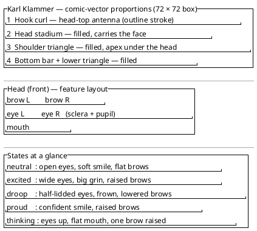

<!-- SPDX-License-Identifier: AGPL-3.0 -->
<!-- Copyright (C) 2024-2026 Breakdown RS Contributors -->
<!-- Co-authored-by: hy3 (opencode-go) -->

# Design: Karl Klammer figure redesign (issue #614)

## Context

The figure lives in `karl_klammer_figure.dart`: `KarlKlammerFigure` (a
`StatefulWidget` owning the animation controller) + `_HangerPainter`
(the drawing). It is rendered by `KarlKlammerOverlay` at 72 px logical
size and consumed by the AI-Import screens. Colors come exclusively from
the ambient Material 3 color-scheme roles; the pose is a `ClippyPose`
resolved by the pure trigger `clippyTipFor` in `clippy_trigger.dart`.

Current deficiencies (verified in code, issue #614): stroke-only outline;
eyes are 1.1 px dots (invisible); only `excited` animates; the "lower
triangle" the comment promises is not drawn.

## Goals / Non-Goals

**Goals**
- A recognisable clothes-hanger character with a clearly visible,
  expressive face (eyes with sclera + pupils, eyebrows, pose mouths).
- A filled comic-vector silhouette that reads at small sizes.
- Deterministic blink + idle motion + a distinct motion signature per pose.
- Extended trigger set (new `queued`/`thinking` reaction, larger idle set),
  keeping `clippyTipFor` pure.
- Preserve every accessibility guarantee of the #516 change.

**Non-Goals**
- No binary/image assets (PO decision: `CustomPainter` only).
- No change to the overlay's placement, dismissal, semantics, or gating.
- No new colors outside the M3 color-scheme roles (design-token rule).
- No copying of Microsoft Clippy/Karl Klammer artwork — original own work.

## Decisions

### D1 — Filled comic-vector silhouette (PO decision)
The body becomes a filled triangle (hook, head, shoulders, bottom bar,
lower triangle). Fill `colorScheme.primary`, edge `colorScheme.outline`.
This is the "filled body silhouette" the PO chose so the figure reads at
72 px and below.

### D2 — Head = hook/stem, face features on it
The hook curl sits on top as an antenna; the stem widens into a filled
stadium head. Features:
- **Sclera** `colorScheme.onPrimary`, **pupils** `colorScheme.primary`,
  **eyebrows/mouth** `colorScheme.onPrimary` — all contrast against the
  `primary` head in light AND dark themes.
- Eyes are ~3.4 px radius at the 72 px box (≈3× the old dots), so they are
  perceivable.

### D3 — One controller drives body motion AND blink (deterministic)
A single `AnimationController` repeats with a fixed duration
(`_cycle = 4200 ms`). Inside `paint`:
- `blinkPhase = controller.value` → eyes closed when
  `karlEyesClosed(phase)` (a small window around 0.5).
- `bodyPhase = (controller.value * cycle / posePeriod) % 1` → per-pose
  motion via `sin(2π · bodyPhase)`.

Because both are pure functions of one injected phase, widget tests drive
them with `tester.pump(duration)` — no wall clock, no randomness. When
`animate` is false (system "remove animations") no controller is created
and the figure renders the static pose at phase 0.

### D4 — Trigger extension
`ClippyFlowState.queued` (job pending, not yet running) maps to
`ClippyPose.thinking`; `ClippyFlowState.running` stays `excited`. The idle
joke set grows to five keys with deterministic pose cycling
(`neutral, thinking, neutral, thinking, neutral`). `clippyTipFor` stays
pure and Flutter-import-free (Tier-1).

## Proportions & expression sketch

Static structure only (Salt = layout, never behavior — the animation
timing lives in D3 and the spec scenarios). The sketch documents the
vertical proportion bands of the 72 × 72 logical box and the head's
feature layout; the expression table below lists the per-pose states.

### Expression states per pose (normative)

| Pose | Eyes | Eyebrows | Mouth | Motion signature |
|---|---|---|---|---|
| `neutral` | open, centred pupils | level | soft smile | gentle bob + sway |
| `excited` | wide, centred pupils | raised | big open grin | energetic swing |
| `droop` | half-lidded, pupils down | lowered/outward | downturned frown | slow sag to one side |
| `proud` | open, centred pupils | raised | confident smile | upright bounce |
| `thinking` | open, pupils up | one raised | flat/small | slow sway |

## Risks / Trade-offs

- [Filled silhouette vs. recognisability] → the hook + triangle keep the
  hanger read; goldens at 72 px verify it visually.
- [One controller for motion + blink] → blink frequency is tied to the
  motion cycle; acceptable for a comic figure and keeps determinism.
- [New `queued` state touches job screens] → the mapping change is one
  switch arm per screen; existing `running`/`error`/`success` mappings are
  unchanged.
- [Regenerated goldens] → expected: the figure changed; the repaint/blink
  proof tests are updated to the new phases.

## Migration Plan

1. Author this change (proposal/design/spec/tasks).
2. Extend `clippy_trigger.dart` (pure, Tier-1 tests first).
3. Rework the painter + animation; regenerate goldens; inspect them.
4. Map `JobStatus.pending` → `queued` in the job screens.
5. Add l10n keys + glossary rows; `flutter gen-l10n`.
6. Validate: `dart format`, `flutter analyze`, `flutter test`, design-lint,
   `openspec validate`.

Rollback: revert the commit; the #516 behavior is restored untouched.

## Open Questions

None — the PO decisions (comic-vector direction, animation scope,
code-drawn technique) are fixed in issue #614.
