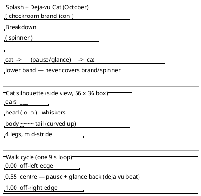

<!-- SPDX-License-Identifier: AGPL-3.0 -->
<!-- Copyright (C) 2024-2026 Breakdown RS Contributors -->
<!-- Co-authored-by: deepseek-v4.1-flash (neuralwatt) -->

# Design: Deja-vu Cat + per-egg Easter-egg configuration (issue #615)

## Context

`SplashView` (`lib/app.dart`) is the launch surface rendered while the
session restore is in flight. The single global Easter-egg toggle lives in
`lib/data/settings/easter_eggs_store.dart` (`EasterEggsStore.key =
'easter_eggs'`), is hydrated by `bootstrap()` before the first consumer,
and is consumed by the Karl Klammer overlay
(`lib/features/ai_import/clippy/karl_klammer_overlay.dart`) and the
settings screen. The deterministic-clock and "remove animations" patterns
already exist in the Karl Klammer figure/overlay and are reused here.

## Goals / Non-Goals

**Goals**
- Per-egg preference with independent switches (Karl Klammer, Deja-vu Cat).
- Legacy `easter_eggs` migration with a safe default-ON fallback.
- An original, code-drawn October-only black cat crossing the splash.
- Deterministic month gate via an injectable clock; deterministic looping
  walk; "remove animations" static fallback.
- Preserve every accessibility and reactivity guarantee of #516/#614.

**Non-Goals**
- No binary/image assets (`CustomPainter` only).
- No Matrix film assets, titles, or copied artwork — original own work.
- No artificial extension of the splash/restore duration.
- No offline persistence, no backend/API change.

## Decisions

### D1 — Flat per-egg persistence keys (PO pre-reference)
`EasterEggId` enum with explicit wire keys:

| Egg id | Preferences key |
|---|---|
| `karlKlammer` | `easter_eggs.karl_klammer` |
| `dejaVuCat` | `easter_eggs.dejavu_cat` |

Flat keys are simpler than a JSON blob and survive partial writes: one
egg's corrupt/missing key never affects the other. The legacy key
`easter_eggs` remains only as the migration source.

### D2 — Legacy migration
On first launch after the update, `EasterEggsStore.readAll()` reads every
per-egg key plus the legacy key. When the legacy key is present it seeds
**only eggs with no stored value** (defensive: a partially-migrated install
keeps its explicit per-egg choices), then removes the legacy key. A read
failure anywhere falls back to default **ON** per egg with the notifier's
`readFailed` flag raised — the settings screen renders a visible error
state, never a silent failure. A failed `remove` of the legacy key is
non-fatal: the key is simply ignored on the next boot (documented leftover).

### D3 — Per-egg notifier family
`NotifierProvider.family<EasterEggs, bool, EasterEggId>` replaces the single
`easterEggsProvider`. The notifier stores its `EasterEggId` and
`toggle(store)` writes that egg's key. `HydratedEasterEggs` carries the
bootstrap-resolved initial value + failure flag; `bootstrap()` overrides the
whole family once with `overrideWith2((id) => HydratedEasterEggs(...))`.
Consumers `ref.watch(easterEggProvider(id))`; flipping one egg never
rebuilds the other.

### D4 — October gate is a pure function with an injectable clock
`dejaVuCatActive({required bool enabled, required DateTime now}) =>
enabled && now.month == DateTime.october`. Pure, Flutter-import-free
(Tier-1). The widget supplies the clock from an injectable provider
(`dejaVuCatClockProvider`, default `DateTime.now`); tests override it with
a fixed date. No month logic is buried in a widget.

### D5 — Loop the walk; never stretch the splash
A single repeating `AnimationController` (≈9 s) drives the cat. The walk
travel function moves the cat fully off the left edge to fully off the
right edge with a **pause/glance beat** (the "déjà vu" moment) around
55–65 % of the cycle:

```
travel(phase) = phase / 0.55 * 0.5              phase ≤ 0.55   (walk in)
              = 0.5                            0.55 < phase < 0.65 (pause)
              = 0.5 + (phase-0.65)/0.35 * 0.5    phase ≥ 0.65   (walk out)
```

`glance(phase)` peaks mid-pause and is 0 outside it. Both are pure. The
animation loops continuously while the splash is up; when the restore
completes the splash (and the cat) simply disappear — no linger.

### D6 — Splash stage & placement
The cat is drawn as a dark silhouette using `colorScheme.onSurface`
(contrasts against `surface` in light AND dark themes — a black cat on the
light splash, a light silhouette on the dark splash). It walks along the
lower band of the splash, above the bottom edge, never covering the brand
icon/wordmark/spinner. The overlay is wrapped in `IgnorePointer` (the
splash has no interaction) and honours `MediaQuery.disableAnimations`
(static pose at the pause beat, no controller).

### D7 — Settings rows
The "Easter eggs" section keeps its header (`settingsEasterEggs`) and
explanatory line (`settingsEasterEggsSubtitle`), followed by one
`SwitchListTile` per `EasterEggId` (`settings-egg-<id>`), each with a
localized name + short description. On read failure each row shows the
localized visible error subtitle (`settingsEasterEggsError`) under a keyed
error widget.

## Proportions & walk sketch

Static layout only (Salt = layout, never behavior — the timing lives in
D5 and the spec scenarios).



## Risks / Trade-offs

- [Black cat vs. dark theme] → `onSurface` inverts per theme, so the
  silhouette always contrasts; a token-only design has no literal "black".
- [Existing splash goldens] → the cat is dormant outside October; the
  splash tests pin the injected clock to a non-October date so the
  pre-existing goldens stay byte-identical year-round.
- [Family notifier migration] → one mechanical rewrite of the two consumers
  (Karl Klammer overlay, settings screen) + bootstrap override; covered by
  the existing overlay/settings tests plus new per-egg tests.
- [Legacy key cleanup] → a failed remove leaves a harmless leftover that
  the next boot re-attempts to clear; the per-egg values already won.

## Migration Plan

1. Author this change (proposal/design/spec/tasks).
2. Refactor the store + notifier family + `bootstrap()` hydration/migration;
   Tier-1 store tests first.
3. Add the pure October gate + walk math; Tier-1 tests.
4. Add the cat painter/overlay; wire it into `SplashView`.
5. Rewire Karl Klammer + settings screen to the family; update their tests.
6. Add l10n keys + glossary/settings-design rows; `flutter gen-l10n`.
7. Validate: `dart format`, `flutter analyze`, `flutter test`, design-lint,
   `openspec validate`.

Rollback: revert the commit; the #516/#614 single-toggle behavior is
restored untouched.

## Open Questions

None — the PO decisions (flat keys, October-only, original code-drawn cat,
per-egg switches) are fixed in issue #615.
